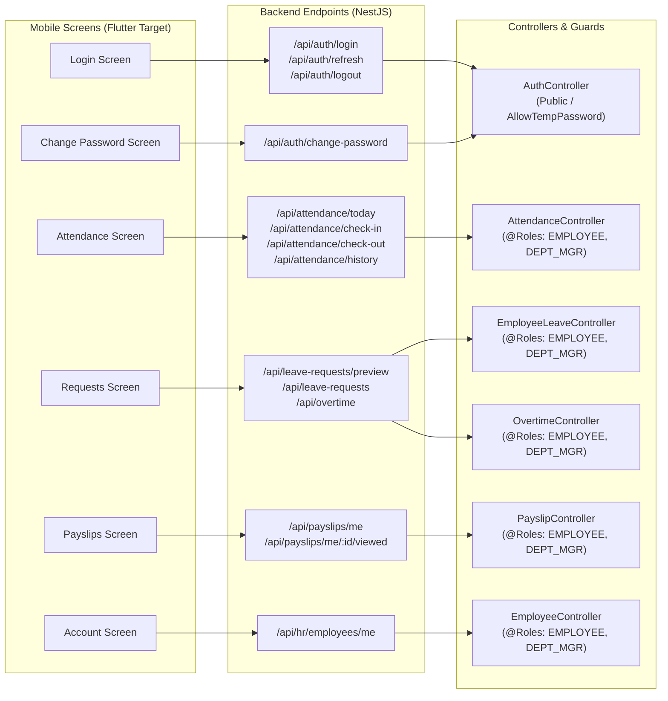
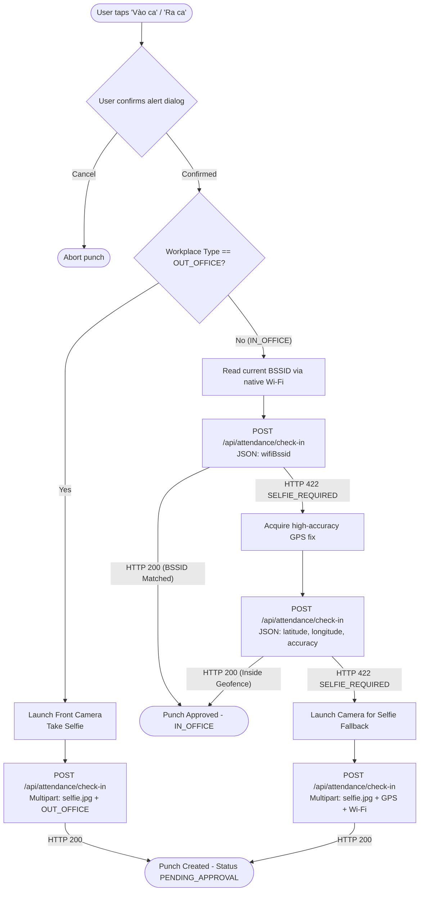

# CORESTAFF MOBILE — DEEP CODEBASE & ARCHITECTURAL MIGRATION AUDIT (FLUTTER)

> **Document Version:** 1.0.0  
> **Date:** 2026-11-03  
> **Author:** Senior Software Architect & Senior Flutter Migration Engineer  
> **Status:** AUDIT COMPLETE — PENDING STAKEHOLDER APPROVAL  
> **Target Scope:** Monorepo analysis of `Apps/mobile` (Expo React Native), `Apps/mobile_flutter` (Flutter Target), and `Apps/api` (NestJS Backend).

---

## Table of Contents

1. [Executive Summary](#1-executive-summary)
2. [React Native Source Code Audit (`Apps/mobile`)](#2-react-native-source-code-audit-appsmobile)
   - 2.1 Screen & Route Inventory
   - 2.2 Component Hierarchy & Reusable UI
   - 2.3 Network Client, Token & Cookie Architecture
   - 2.4 State Management & Realtime Event Synchronization
   - 2.5 Role-Based Access Control & Security Guards
   - 2.6 Native Plugins, Hardware Access & Permissions
   - 2.7 State Handling & UX Feedback
3. [Flutter Target Codebase Audit (`Apps/mobile_flutter`)](#3-flutter-target-codebase-audit-appsmobile_flutter)
   - 3.1 Existing Folder Structure & Project Layout
   - 3.2 Implemented Screens, Tabs & Widgets
   - 3.3 Routing, Navigation & Shell Architecture
   - 3.4 State Management Assessment
   - 3.5 Networking & Cookie Session Persistence
   - 3.6 Dependency Audit & Gap Analysis
   - 3.7 Platform Configuration (Android & iOS)
   - 3.8 Existing Tests & Testability Deficiencies
   - 3.9 Skeleton Evaluation: Extend vs. Restructure
4. [Backend Contract & API Traceability Audit (`Apps/api`)](#4-backend-contract--api-traceability-audit-appsapi)
   - 4.1 Relevant Module Controllers & Guards
   - 4.2 Endpoint Specifications, Payloads & DTOs
   - 4.3 Domain Error Code Catalog
5. [Comprehensive Feature Inventory Table](#5-comprehensive-feature-inventory-table)
6. [API Traceability Matrix](#6-api-traceability-matrix)
7. [Native Dependency & Platform Matrix](#7-native-dependency--platform-matrix)
8. [End-to-End Workflow Analysis](#8-end-to-end-workflow-analysis)
   - 8.1 Authentication & Session Refresh Flow
   - 8.2 Mandatory Temporary Password Change Flow
   - 8.3 Attendance Verification & Punch Flow (Wi-Fi → GPS → Selfie Fallback)
   - 8.4 Attendance Check-Out Flow
   - 8.5 Leave Request Submission & Calculation Flow
   - 8.6 Overtime Request Submission & Autonomous Classification Flow
   - 8.7 Payslip Inspection & Read-Receipt Audit Flow
   - 8.8 Account Profile Inspection & Secure Sign-Out Flow
9. [Technical Risk & Blocker Analysis](#9-technical-risk--blocker-analysis)
   - 9.1 Cookie-Based Authentication & Session Persistence
   - 9.2 Session Refresh Races & Concurrent HTTP Requests
   - 9.3 Wi-Fi BSSID Extraction Across Android & iOS
   - 9.4 GPS Geofencing Precision & Accuracy Threshold Filtering
   - 9.5 Camera Streaming & Multipart Selfie Uploads
   - 9.6 Timezone Rigidity (`Asia/Ho_Chi_Minh` UTC+7)
   - 9.7 Platform Permission & Background Restrictions
10. [Facts, Assumptions & Unknowns](#10-facts-assumptions--unknowns)
11. [Architectural Recommendations & Next Steps](#11-architectural-recommendations--next-steps)

---

## 1. Executive Summary

CoreStaff is a multi-tenant enterprise Human Resource, Attendance, and Payroll management system tailored for Vietnamese labor regulations (BHXH 8%, BHYT 1.5%, BHTN 1%, and progressive PIT). 

The mobile application acts as the primary employee self-service client, enabling:
- Multi-tier attendance punch verification (Network Wi-Fi BSSID matching, GPS geofencing via Haversine calculation with accuracy threshold filtering, and manager-approved photo selfie fallback).
- Leave request drafting with real-time shift interval preview.
- Overtime request creation with strict backend type classification and schedule overlap prevention.
- Personal payslip inspection with read-receipt audit logging.
- Account profile viewing and mandatory password updates.

The current monorepo hosts an Expo React Native client (`Apps/mobile`) and an early Flutter skeleton (`Apps/mobile_flutter`). This audit provides an evidence-based assessment of both codebases and backend contracts to prepare for migrating the mobile experience to Flutter.

**Audit Verdict:**
- `Apps/mobile` is feature-complete for the employee persona, featuring a 5-tab shell, reactive WebSocket refresh, custom Wi-Fi BSSID reading via native dev client, and resilient HTTP cookie session handling with transparent silent refresh.
- `Apps/mobile_flutter` is currently an **incomplete UI skeleton**. It implements authentication screens (login, forgot, reset, change password) and an `OverviewTab` layout, but its `AttendanceTab` and `RequestsTab` are empty placeholders. It lacks a `Payslips` tab, lacks multipart upload support, lacks GPS/camera/Wi-Fi native plugins, and relies on unencrypted `SharedPreferences` with custom regex parsing for HTTP cookie management.
- Complete restructuring of the network, storage, state management, and native integration layers is required before feature parity can be achieved.

---

## 2. React Native Source Code Audit (`Apps/mobile`)

### 2.1 Screen & Route Inventory

The React Native application manages screen routing using a state-machine pattern within `Apps/mobile/App.tsx`, rather than an external navigation container like React Navigation.

| Screen / Route | Source File | Component / Symbol | Navigation Trigger / Role |
|---|---|---|---|
| `LoadingScreen` | `Apps/mobile/App.tsx:67-69` | `LoadingScreen` | Initial bootstrap while probing API base URL |
| `ConnectionError` | `Apps/mobile/App.tsx:71-73` | `ConnectionError` | API unreachable on both primary and fallback URLs |
| `LoginScreen` | `Apps/mobile/App.tsx:83-92` | `LoginScreen` | Unauthenticated users; root entry |
| `ForgotScreen` | `Apps/mobile/App.tsx:94-98` | `ForgotScreen` | Password recovery via email token request |
| `ResetScreen` | `Apps/mobile/App.tsx:100-104` | `ResetScreen` | Password reset using email token and new password |
| `ChangePasswordScreen` | `Apps/mobile/App.tsx:106-110` | `ChangePasswordScreen` | Mandatory (`mustChangePassword: true`) or voluntary via Account |
| `EmployeeHome` | `Apps/mobile/App.tsx:112-138` | `EmployeeHome` | Authenticated container for `EMPLOYEE` & `DEPARTMENT_MANAGER` |
| ├── `OverviewScreen` | `Apps/mobile/src/screens/OverviewScreen.tsx:10` | `OverviewScreen` | Tab 1: Shift summary, quick actions, pending badges |
| ├── `AttendanceScreen` | `Apps/mobile/src/screens/AttendanceScreen.tsx:34` | `AttendanceScreen` | Tab 2: Clock, live punch actions, monthly calendar history |
| ├── `RequestsScreen` | `Apps/mobile/src/screens/RequestsScreen.tsx:11` | `RequestsScreen` | Tab 3: Request list (leave/OT), filter tabs |
| │   └── `RequestModal` | `Apps/mobile/src/screens/RequestsScreen.tsx:54` | `RequestModal` | Modal sheet: Leave creation (preview) & OT creation |
| ├── `PayslipsScreen` | `Apps/mobile/src/screens/PayslipsScreen.tsx:7` | `PayslipsScreen` | Tab 4: Latest earnings card, history, expandable breakdown |
| └── `AccountScreen` | `Apps/mobile/src/screens/AccountScreen.tsx:11` | `AccountScreen` | Tab 5: Profile, contact details, payslips sub-view, sign out |

### 2.2 Component Hierarchy & Reusable UI

`Apps/mobile/src/components/` supplies modular design tokens and UI controls:
- **`ui.tsx` (`Apps/mobile/src/components/ui.tsx`):**
  - `Card`: Bordered surface with light/dark theme variants (`Card dark` used for shift/punch cards).
  - `AppButton`: Button with primary, secondary, and danger styles, supporting loading spinners and disabled states.
  - `Field`: Accessible text input wrapper supporting labels, required indicators, inline action buttons (e.g., password visibility toggle), and error styling.
  - `StatusBadge`: Maps domain statuses (`NOT_CHECKED_IN`, `CHECKED_IN`, `COMPLETED`, `PENDING`, `APPROVED`, `REJECTED`, etc.) to semantic badge styles.
  - `ErrorBanner` / `SuccessBanner`: Accessible alert banners (`accessibilityRole="alert"`).
  - `EmptyState` / `ErrorState`: Consistent illustrations and retry triggers for network/data failures.
  - Formatters: `formatMoney`, `formatDate`, `formatTime`, `formatMinutes`.
- **`BottomTabBar.tsx` (`Apps/mobile/src/components/BottomTabBar.tsx:20-57`):**
  - 5 tabs: `overview`, `requests`, `attendance` (raised primary center action button with navy/blue circular elevation), `payslips`, `account`.
- **`AppIcon.tsx` (`Apps/mobile/src/components/AppIcon.tsx`):**
  - Wrapper around `@expo/vector-icons/Ionicons` with type-safe iconography.
- **`theme.ts` (`Apps/mobile/src/theme.ts`):**
  - Enterprise color palette (`primary: #2563eb`, `navy: #172554`, `background: #f6f8fc`, `surface: #ffffff`, semantic text and border shades).

### 2.3 Network Client, Token & Cookie Architecture

- **HTTP Engine (`Apps/mobile/src/auth.ts:46-74`):**
  - Uses native `fetch` with `credentials: 'include'` (`EXPO_PUBLIC_USE_RN_FETCH=1`).
  - Dual-token session lifecycle:
    - `sid` (Session ID): Short-lived (30 min idle TTL), HttpOnly cookie verified by server against hashed session tokens.
    - `rt` (Refresh Token): Long-lived (14 days), HttpOnly cookie rotated at `POST /api/auth/refresh`.
  - **Transparent Refresh:** When any non-credential request returns HTTP `401`, `apiRequest` catches the status and invokes `tryRefreshSession(base)` (`Apps/mobile/src/auth.ts:83-91`).
  - **In-Flight Concurrency Throttling:** `refreshInflight` promise memoization prevents multiple concurrent requests from racing to refresh the session token simultaneously.
  - If refresh fails, `signedOutHandler` fires, resetting application state and returning the user to `LoginScreen`.
- **Endpoint Failover Discovery (`Apps/mobile/src/config.ts:65-74`):**
  - Probes remote API (`REMOTE_API_URL`, default `https://18-141-68-40.sslip.io`) with a 4000ms timeout (`Apps/mobile/src/config.ts:36-59`).
  - If unreachable in `__DEV__`, falls back to local API (`FALLBACK_API_URL`, rewriting `localhost` to `10.0.2.2` for Android emulator).

### 2.4 State Management & Realtime Event Synchronization

- **Component State:** Built purely with React hooks (`useState`, `useEffect`, `useCallback`, `useMemo`). No Redux, Zustand, or MobX.
- **Realtime WebSocket Synchronization (`Apps/mobile/src/realtime.ts:18-44`):**
  - Connects to NestJS Socket.io gateway at `/events` using `transports: ['polling', 'websocket']` to pass session cookies during HTTP handshake.
  - Listens to domain events:
    - `request:decided`
    - `attendance:changed`
    - `leave:changed`
    - `payslip:released`
    - `compliance:warning`
  - In `EmployeeHome` (`Apps/mobile/App.tsx:120`), socket events increment `realtimeRevision`.
  - `AppState.addEventListener('change', ...)` (`Apps/mobile/App.tsx:124-127`) increments `realtimeRevision` whenever the mobile app returns from the background to foreground.
  - All tabs receive `realtimeRevision` as a prop and automatically re-fetch fresh server data when it increments.

### 2.5 Role-Based Access Control & Security Guards

- **Role Filtering (`Apps/mobile/App.tsx:117, 129`):**
  - `user.role === 'HR' || user.role === 'SYSTEM_ADMIN'` triggers an administrative block notice:
    > "Cổng quản trị Web: Tài khoản vai trò Nhân sự (HR) / Quản trị hệ thống (System Admin) cần sử dụng cổng quản trị web."
  - Only `EMPLOYEE` and `DEPARTMENT_MANAGER` can access mobile workspace tabs.
- **Enforced Password Change (`Apps/mobile/App.tsx:37-38`):**
  - If `user.mustChangePassword === true`, application state pins screen to `change-password`, preventing navigation until the temporary password is replaced.

### 2.6 Native Plugins, Hardware Access & Permissions

- **Wi-Fi BSSID Extraction (`Apps/mobile/src/wifi.ts:30-38`):**
  - Utilizes `react-native-network-info` (`NetworkInfo.getBSSID()`, `NetworkInfo.getSSID()`).
  - Requires Custom Dev Client (`expo-dev-client`); fails gracefully to `{}` on standard Expo Go.
  - Cleans MAC strings, normalizes to lowercase, and strips Android quotation wrappers.
- **GPS Location (`Apps/mobile/src/screens/AttendanceScreen.tsx:15-24`):**
  - Utilizes `expo-location` (`Location.requestForegroundPermissionsAsync()`, `Location.getCurrentPositionAsync({ accuracy: Location.Accuracy.High })`).
- **Camera & Selfie (`Apps/mobile/src/screens/AttendanceScreen.tsx:27-32`):**
  - Utilizes `expo-image-picker` (`ImagePicker.requestCameraPermissionsAsync()`, `ImagePicker.launchCameraAsync({ mediaTypes: 'images', quality: 0.6 })`).
  - Uploads photo via `FormData` as `selfie.jpg` (`image/jpeg`).

### 2.7 State Handling & UX Feedback

- **Loading States:** `LoadingBlock` displays skeleton indicators; buttons display spinning `ActivityIndicator`.
- **Empty States:** `EmptyState` displays contextual iconography and descriptive Vietnamese text when lists (leaves, overtime, payslips) contain 0 items.
- **Error States:** `ErrorBanner` displays inline alerts with human-readable error messages via `friendlyEmployeeError` (`Apps/mobile/src/employee-api.ts:258-279`) and `friendlyAuthError` (`Apps/mobile/src/auth.ts:108-120`).
- **Success Feedback:** `SuccessBanner` confirms punch and request submissions.

---

## 3. Flutter Target Codebase Audit (`Apps/mobile_flutter`)

### 3.1 Existing Folder Structure & Project Layout

```text
Apps/mobile_flutter/
├── android/                   # Kotlin Gradle project (minSdk default, compileSdk default)
├── ios/                       # Runner Xcode project
├── lib/
│   ├── core/
│   │   ├── config/            # api_config.dart (URL resolver & healthz check)
│   │   ├── network/           # api_client.dart (Manual cookie http client), api_exception.dart
│   │   └── theme/             # app_colors.dart, app_theme.dart, app_typography.dart
│   ├── models/                # auth_user.dart (Data class for login identity)
│   ├── screens/
│   │   ├── account/           # account_tab.dart (Basic profile & logout dialog)
│   │   ├── attendance/        # attendance_tab.dart (EMPTY STUB - FeatureScreen placeholder)
│   │   ├── auth/              # login_screen.dart, forgot_password_screen.dart, reset_password_screen.dart, change_password_screen.dart
│   │   ├── overview/          # overview_tab.dart (Static mock layout of overview)
│   │   ├── requests/          # requests_tab.dart (EMPTY STUB - FeatureScreen placeholder)
│   │   ├── splash/            # splash_screen.dart
│   │   └── main_shell_screen.dart # 4-tab bottom navigation shell
│   ├── services/              # auth_service.dart (Auth API caller)
│   ├── widgets/               # app_logo.dart, auth_layout.dart, banners.dart, bottom_tab_bar.dart, buttons.dart, feature_screen.dart, fields.dart
│   └── main.dart              # Application entrypoint & state switcher
├── test/
│   └── widget_test.dart       # BROKEN default template test (references non-existent MyApp)
└── pubspec.yaml               # Dependencies (http, shared_preferences, intl, cupertino_icons)
```

### 3.2 Implemented Screens, Tabs & Widgets

- **Implemented Screens:**
  - `SplashScreen`: Loading brand logo with spinner.
  - `ConnectionErrorScreen`: Network failover error card with retry button.
  - `LoginScreen`: Form for email/employee code + password, show/hide password, auth error banner.
  - `ForgotPasswordScreen`: Email submission for reset token.
  - `ResetPasswordScreen`: Token + new password input with validation.
  - `ChangePasswordScreen`: Current password + new password + confirmation.
  - `MainShellScreen`: Scaffold with bottom tab bar and `IndexedStack`.
- **Placeholder / Incomplete Tabs:**
  - `OverviewTab` (`Apps/mobile_flutter/lib/screens/overview/overview_tab.dart`): UI layout mirrors RN, but **all attendance and badge values are hardcoded mocks**. It makes zero calls to `getTodayAttendance`, `getMyLeaveRequests`, or `getMyPayslips`.
  - `AttendanceTab` (`Apps/mobile_flutter/lib/screens/attendance/attendance_tab.dart`): 19-line stub returning `FeatureScreen` ("Tính năng ghi nhận vào ca, ra ca và lịch sử chấm công đang được hoàn thiện.").
  - `RequestsTab` (`Apps/mobile_flutter/lib/screens/requests/requests_tab.dart`): 19-line stub returning `FeatureScreen` ("Tạo và theo dõi đơn nghỉ phép, tăng ca tại một nơi thuận tiện.").
  - `AccountTab` (`Apps/mobile_flutter/lib/screens/account/account_tab.dart`): Shows email and role from `AuthUser`, but **does not query `/api/hr/employees/me`** for real profile information (department, position, manager, workplace, phone, address).
  - **`PayslipsScreen` / Tab:** **COMPLETELY MISSING**. Neither a tab nor a screen exists in the Flutter project.

### 3.3 Routing, Navigation & Shell Architecture

- `main.dart` manages top-level authentication views via `switch (_currentScreen)` (`login`, `forgot`, `reset`, `changePassword`, `home`).
- Bottom navigation in `MainShellScreen` uses an `IndexedStack` switching between 4 tabs.
- **Architectural Mismatch:**
  - RN has **5 tabs** (`overview`, `requests`, `attendance`, `payslips`, `account`).
  - Flutter has **4 tabs** (`overview`, `attendance`, `requests`, `account`), omitting `payslips` entirely.
  - In RN, `attendance` is centered as a raised FAB action tab. In Flutter, tabs are plain sequential icons.
  - Flutter tab icons are text glyphs (`⌂`, `◷`, `▤`, `○`) in `bottom_tab_bar.dart:32-47` rather than proper vector or Cupertino icons.

### 3.4 State Management Assessment

- Current state management is purely local `StatefulWidget` (`setState`).
- No dependency injection container (such as `provider`, `riverpod`, or `get_it`).
- Services are accessed via static singletons (`AuthService.instance`, `ApiClient.instance`).
- No reactive state store to synchronize cross-tab revisions when requests or punches update.

### 3.5 Networking & Cookie Session Persistence

`ApiClient` (`Apps/mobile_flutter/lib/core/network/api_client.dart`) contains several critical design issues:
1. **Fragile Cookie Extraction (`api_client.dart:37-58`):**
   - Parses the combined `set-cookie` header with `rawSetCookie.split(RegExp(r',(?=\s*[a-zA-Z0-9_-]+=)'))`.
   - In HTTP responses containing cookie attributes with commas (such as `Expires=Wed, 21 Oct 2026 07:28:00 GMT`), regex boundary splitting is fragile and known to corrupt session cookies.
2. **Insecure Storage:**
   - Saves cookies (`cookie_sid`, `cookie_rt`) into `SharedPreferences` as plaintext XML (Android) and plist (iOS). On rooted/jailbroken devices or unencrypted system backups, session tokens are exposed.
3. **Missing Multipart Upload (`api_client.dart:136-150`):**
   - Only supports `http.post(uri, headers: reqHeaders, body: bodyStr)` with `Content-Type: application/json`.
   - Cannot upload `MultipartRequest` form-data for camera selfies required by check-in/out.
4. **Missing WebSocket Support:**
   - No `socket_io_client` dependency; unable to listen to `/events`.

### 3.6 Dependency Audit & Gap Analysis

Inspecting `Apps/mobile_flutter/pubspec.yaml`:
```yaml
dependencies:
  flutter:
    sdk: flutter
  cupertino_icons: ^1.0.8
  http: ^1.6.0
  shared_preferences: ^2.5.6
  intl: ^0.20.3
```

**Missing Essential Packages:**
- `image_picker` or `camera`: Required for selfie attendance verification.
- `geolocator` or `location`: Required for GPS geofencing coordinates and accuracy filtering.
- `network_info_plus`: Required for extracting Wi-Fi BSSID and SSID.
- `permission_handler`: Required to request camera, location, and Wi-Fi runtime permissions.
- `flutter_secure_storage`: Required for encrypted credential and cookie storage.
- `socket_io_client`: Required for real-time manager approvals and timesheet updates.
- `dio` + `dio_cookie_manager` / `cookie_jar`: Recommended replacement for fragile manual cookie parsing.

### 3.7 Platform Configuration (Android & iOS)

- **Android (`Apps/mobile_flutter/android/app/src/main/AndroidManifest.xml`):**
  - Only contains `<uses-permission android:name="android.permission.INTERNET"/>` (`AndroidManifest.xml:2`).
  - **Missing Permissions:**
    - `android.permission.CAMERA`
    - `android.permission.ACCESS_FINE_LOCATION`
    - `android.permission.ACCESS_COARSE_LOCATION`
    - `android.permission.ACCESS_WIFI_STATE`
    - `android.permission.NEARBY_WIFI_DEVICES` (Android 13+)
- **iOS (`Apps/mobile_flutter/ios/Runner/Info.plist`):**
  - **Missing Usage Descriptions:**
    - `NSCameraUsageDescription` (Mandatory for selfie capture)
    - `NSLocationWhenInUseUsageDescription` (Mandatory for GPS punch)
    - `NSLocalNetworkUsageDescription` / Access WiFi Information entitlement (Mandatory for BSSID inspection)

### 3.8 Existing Tests & Testability Deficiencies

- `Apps/mobile_flutter/test/widget_test.dart` is the auto-generated template test:
  ```dart
  await tester.pumpWidget(const MyApp());
  expect(find.text('0'), findsOneWidget);
  ```
  `MyApp` does not exist in `main.dart` (`CoreStaffApp` is the defined widget). **The test currently fails to compile.** There are zero unit or widget tests for auth, network, or business validation in Flutter.

### 3.9 Skeleton Evaluation: Extend vs. Restructure

| Component / Layer | Existing State | Recommendation | Rationale |
|---|---|---|---|
| **Theme & Tokens** | Clean, matches web/mobile design | **EXTEND** | `AppColors`, `AppTypography`, and button styles are clean and match `MOBILE_DESIGN_MASTER.md`. |
| **Auth Screens** | Fully implemented | **EXTEND** | Form layouts, validation, error mapping, and fields are complete. |
| **Network Client** | Manual regex cookie parsing in `http` | **RESTRUCTURE** | Replace with `Dio` + `cookie_jar` or robust RFC 6265 cookie engine to support multipart uploads and reliable session persistence. |
| **Storage Layer** | Plaintext `SharedPreferences` | **RESTRUCTURE** | Migrate session cookies (`sid`, `rt`) to `flutter_secure_storage`. |
| **Navigation Shell** | 4 tabs with unicode glyphs | **RESTRUCTURE** | Align with RN 5-tab specification (`overview`, `requests`, `attendance`, `payslips`, `account`) with raised center FAB and vector icons. |
| **Attendance & Requests** | Empty 19-line stubs | **IMPLEMENT FROM SCRATCH** | Implement full punch pipeline (Wi-Fi, GPS, Selfie) and request modal forms. |

---

## 4. Backend Contract & API Traceability Audit (`Apps/api`)

### 4.1 Relevant Module Controllers & Guards

All mobile endpoints enforce:
1. `AuthGuard` (`Apps/api/src/auth/guards/auth.guard.ts`): Resolves session from cookie `sid`, hashes token, verifies active session in MongoDB, injects `req.user` with tenant context.
2. `RolesGuard` (`Apps/api/src/common/rbac.decorator.ts`): Enforces allowed roles. Mobile employee endpoints require `@Roles('EMPLOYEE', 'DEPARTMENT_MANAGER')`.
3. `@AllowTempPassword()` (`Apps/api/src/auth/guards/auth.guard.ts:24`): Whitelists endpoints accessible when `mustChangePassword === true`.

### 4.2 Endpoint Specifications, Payloads & DTOs

#### A. Health & Authentication
- `GET /api/healthz`
  - Public probe. Response: `{ status: "ok", service: "corestaff-api", mongo: "configured", timezone: "Asia/Ho_Chi_Minh" }`.
- `POST /api/auth/login`
  - Body: `LoginDto` (`Apps/api/src/auth/dto/login.dto.ts:6-14`) `{ identifier: string, password: string }`.
  - Sets HttpOnly `sid` and `rt` cookies.
  - Response: `{ success: true, data: { user: AuthUser, mustChangePassword: boolean } }`.
- `POST /api/auth/refresh`
  - Credentials: `rt` cookie.
  - Sets rotated `sid` cookie.
  - Response: `{ success: true, data: { user: AuthUser } }`.
- `POST /api/auth/logout`
  - Clears `sid` and `rt` cookies; revokes session document in DB.
- `GET /api/auth/me`
  - Returns authenticated user identity.
- `POST /api/auth/change-password`
  - Decorated with `@AllowTempPassword()`.
  - Body: `ChangePasswordDto` `{ currentPassword, newPassword, confirmPassword }`.
- `POST /api/auth/forgot-password`
  - Body: `ForgotPasswordDto` `{ email: string }`.
- `POST /api/auth/reset-password`
  - Body: `ResetPasswordDto` `{ token: string, newPassword: string }`.

#### B. Attendance Tracking
- `GET /api/attendance/today`
  - Controller: `AttendanceController.getToday` (`Apps/api/src/attendance/attendance.controller.ts:43-50`).
  - Response: `TodayAttendance` including shift hours, workplace coordinates, allowed methods, check-in/out events, working minutes, approved leave intervals, and pending leave status.
- `POST /api/attendance/check-in` & `POST /api/attendance/check-out`
  - Controller: `AttendanceController.checkIn` / `checkOut` (`Apps/api/src/attendance/attendance.controller.ts:52-111`).
  - Interceptor: `FileInterceptor('selfie')`.
  - Headers: `Idempotency-Key: string`.
  - Body: `CheckInDto` / `CheckOutDto` (`Apps/api/src/attendance/dto/check-in.dto.ts:28-68`).
    - `workMode`: `'IN_OFFICE'` | `'OUT_OFFICE'` (check-in only).
    - `latitude?: number`, `longitude?: number`, `accuracyMeters?: number`, `address?: string`.
    - `wifiSsid?: string`, `wifiBssid?: string`.
    - `note?: string`.
    - `selfie?: Express.Multer.File` (multipart file stream).
- `GET /api/attendance/history`
  - Query: `month=YYYY-MM`.
  - Response: Monthly attendance aggregation (working days, late days, OT minutes, items array).

#### C. Leave Management
- `GET /api/leave-requests/mine`
  - Controller: `EmployeeLeaveController.mine` (`Apps/api/src/hr/leave/leave.controller.ts:18`).
  - Response: Array of `LeaveRequest`.
- `POST /api/leave-requests/preview`
  - Body: `PreviewLeaveRequestDto` (`Apps/api/src/hr/leave/dto/leave.dto.ts:16-22`) `{ startDate, endDate, durationType, requestedStart?, requestedEnd? }`.
  - Returns exact shift-aligned working hours, break deductions, and leave equivalent.
- `POST /api/leave-requests`
  - Body: `CreateLeaveRequestDto` (`Apps/api/src/hr/leave/dto/leave.dto.ts:5-14`) `{ startDate, endDate, leaveType, durationType, requestedStart?, requestedEnd?, reason }`.
- `POST /api/leave-requests/mine/:id/cancel`
  - Cancels a pending leave request.

#### D. Overtime Management
- `GET /api/overtime/mine`
  - Controller: `OvertimeController.mine` (`Apps/api/src/hr/overtime/overtime.controller.ts:75-82`).
  - Query: `month=YYYY-MM`.
- `POST /api/overtime`
  - Controller: `OvertimeController.create` (`Apps/api/src/hr/overtime/overtime.controller.ts:19-65`).
  - Body: `CreateOvertimeRequestDto` (`Apps/api/src/hr/overtime/dto/overtime.dto.ts:19-30`) `{ workDate, requestedStart, requestedEnd, reason, workDescription?, retroactiveReason? }`.
  - **Strict Rule (BR-OT-01):** The client CANNOT submit `overtimeType`. If submitted, the backend rejects it with `400 OVERTIME_SELF_TYPE_FORBIDDEN`.

#### E. Employee Profile & Payslips
- `GET /api/hr/employees/me`
  - Controller: `EmployeeController.me` (`Apps/api/src/hr/employee/employee.controller.ts:104-114`).
  - Response: Personal `EmployeeProfile` with resolved department, position, workplace, and manager names.
- `GET /api/payslips/me`
  - Controller: `PayslipController.getMyPayslips` (`Apps/api/src/hr/payroll/payslip.controller.ts:21-45`).
  - Response: Array of released `Payslip` items.
- `POST /api/payslips/me/:id/viewed`
  - Controller: `PayslipController.markViewed` (`Apps/api/src/hr/payroll/payslip.controller.ts:70-83`).
  - Sets payslip status to `VIEWED` and logs read-receipt audit timestamp.

### 4.3 Domain Error Code Catalog

The backend `HttpExceptionFilter` transforms business faults into standardized error responses:

```json
{
  "statusCode": 422,
  "error": "UNPROCESSABLE_ENTITY",
  "message": "SELFIE_REQUIRED",
  "timestamp": "2026-11-03T06:19:00.000Z",
  "path": "/api/attendance/check-in"
}
```

| Error Code | HTTP Status | Business Trigger | Required Mobile Behavior |
|---|---|---|---|
| `AUTH_INVALID_CREDENTIALS` | 401 | Invalid username or password | Show inline form error banner |
| `AUTH_SESSION_EXPIRED` | 401 | Session cookie `sid` expired/invalid | Execute `POST /api/auth/refresh`; redirect to login if refresh fails |
| `AUTH_PASSWORD_CHANGE_REQUIRED`| 403 | User has `mustChangePassword: true` | Lock navigation; display `ChangePasswordScreen` |
| `AUTH_ACCOUNT_LOCKED` | 423 | 5 consecutive failed login attempts | Display lockout duration message |
| `ASSIGNMENT_NOT_CONFIGURED` | 400 | Employee has no active shift/workplace | Inform user to contact HR; disable punch buttons |
| `ALREADY_CHECKED_IN` | 409 | Check-in attempted when status is `CHECKED_IN` | Refresh today status; update action button |
| `ALREADY_CHECKED_OUT` | 409 | Check-out attempted when status is `COMPLETED` | Refresh today status; show completed card |
| `SELFIE_REQUIRED` | 422 | BSSID mismatch and GPS outside geofence | Fall back automatically to camera selfie capture |
| `LOW_LOCATION_ACCURACY` | 422 | GPS `accuracyMeters > maximumAccuracyMeters` | Advise user to move outdoors; fall back to selfie |
| `OUTSIDE_ALLOWED_AREA` | 422 | Outside geofence with selfie fallback disabled | Display geofence breach alert |
| `ATTENDANCE_LOCKED` | 409 | Timesheet period is locked/closed | Block attendance mutations |
| `OVERTIME_OVERLAPS_SCHEDULE` | 400 | OT window overlaps regular shift | Block submission; highlight conflicting hours |
| `OVERTIME_SELF_TYPE_FORBIDDEN` | 400 | Client supplied manual OT type | Strip OT type; allow backend auto-classification |
| `OVERTIME_RETROACTIVE_REASON_REQUIRED`| 400 | OT submitted after shift completion | Require non-empty `retroactiveReason` field |

---

## 5. Comprehensive Feature Inventory Table

| Feature | RN Screen | RN Service / Function | API Endpoint | Flutter Status | Native Dependency | Classification |
|---|---|---|---|---|---|---|
| **API Health & Probe** | `App.tsx` | `config.ts:getHealth` | `GET /api/healthz` | IMPLEMENTED | None (HTTP) | IMPLEMENTED |
| **User Login** | `LoginScreen.tsx` | `auth.ts:login` | `POST /api/auth/login` | IMPLEMENTED | Secure Cookie Storage | IMPLEMENTED |
| **Token Session Refresh** | `auth.ts` | `auth.ts:tryRefreshSession`| `POST /api/auth/refresh` | PARTIALLY_IMPLEMENTED | HTTP Client / Cookie Jar | PARTIALLY_IMPLEMENTED |
| **User Logout** | `AccountScreen.tsx`| `auth.ts:logout` | `POST /api/auth/logout` | IMPLEMENTED | Cookie Clear | IMPLEMENTED |
| **Forgot Password** | `ForgotScreen.tsx` | `auth.ts:forgotPassword` | `POST /api/auth/forgot-password`| IMPLEMENTED | None (HTTP) | IMPLEMENTED |
| **Reset Password** | `ResetScreen.tsx` | `auth.ts:resetPassword` | `POST /api/auth/reset-password` | IMPLEMENTED | None (HTTP) | IMPLEMENTED |
| **Forced Password Change** | `ChangePasswordScreen.tsx`| `auth.ts:changePassword` | `POST /api/auth/change-password`| IMPLEMENTED | None (HTTP) | IMPLEMENTED |
| **Voluntary Password Change** | `ChangePasswordScreen.tsx`| `auth.ts:changePassword` | `POST /api/auth/change-password`| IMPLEMENTED | None (HTTP) | IMPLEMENTED |
| **Administrative Role Block** | `App.tsx` | Local role check | N/A (Client Guard) | IMPLEMENTED | None | IMPLEMENTED |
| **Overview Screen Layout** | `OverviewScreen.tsx`| N/A (UI Shell) | N/A | IMPLEMENTED | None | IMPLEMENTED |
| **Overview Live Shift State** | `OverviewScreen.tsx`| `employee-api.ts:getTodayAttendance`| `GET /api/attendance/today` | NOT_IMPLEMENTED | None (HTTP) | NOT_IMPLEMENTED |
| **Overview Badges & Counts** | `OverviewScreen.tsx`| `getMyLeaveRequests`, `getMyPayslips`| `GET /api/leave-requests/mine`, `GET /api/payslips/me` | NOT_IMPLEMENTED | None (HTTP) | NOT_IMPLEMENTED |
| **Attendance State & Shift Info**| `AttendanceScreen.tsx`| `employee-api.ts:getTodayAttendance`| `GET /api/attendance/today` | NOT_IMPLEMENTED | None (HTTP) | NOT_IMPLEMENTED |
| **Wi-Fi BSSID Punch Check** | `AttendanceScreen.tsx`| `wifi.ts:currentWifi` | `POST /api/attendance/check-in`| NOT_IMPLEMENTED | Wi-Fi Manager / Network Info | NOT_IMPLEMENTED |
| **GPS Geofence Punch Check** | `AttendanceScreen.tsx`| `AttendanceScreen.tsx:currentLocation`| `POST /api/attendance/check-in`| NOT_IMPLEMENTED | GPS Location Service | NOT_IMPLEMENTED |
| **Camera Selfie Punch Fallback**| `AttendanceScreen.tsx`| `AttendanceScreen.tsx:takeSelfie`| `POST /api/attendance/check-in`| NOT_IMPLEMENTED | Camera / Multipart HTTP | NOT_IMPLEMENTED |
| **Attendance Check-Out** | `AttendanceScreen.tsx`| `employee-api.ts:punchAttendance`| `POST /api/attendance/check-out`| NOT_IMPLEMENTED | Wi-Fi / GPS / Camera | NOT_IMPLEMENTED |
| **Monthly Attendance History**| `AttendanceScreen.tsx`| `employee-api.ts:getAttendanceHistory`| `GET /api/attendance/history`| NOT_IMPLEMENTED | None (HTTP) | NOT_IMPLEMENTED |
| **Leave Request List & Filtering**| `RequestsScreen.tsx`| `employee-api.ts:getMyLeaveRequests`| `GET /api/leave-requests/mine`| NOT_IMPLEMENTED | None (HTTP) | NOT_IMPLEMENTED |
| **Leave Working Interval Preview**| `RequestsScreen.tsx`| `employee-api.ts:previewLeaveRequest`| `POST /api/leave-requests/preview`| NOT_IMPLEMENTED | None (HTTP) | NOT_IMPLEMENTED |
| **Leave Request Submission** | `RequestsScreen.tsx`| `employee-api.ts:createLeaveRequest`| `POST /api/leave-requests` | NOT_IMPLEMENTED | None (HTTP) | NOT_IMPLEMENTED |
| **Leave Request Cancellation**| `employee-api.ts` | `employee-api.ts:cancelMyLeaveRequest`| `POST /api/leave-requests/mine/:id/cancel`| NOT_IMPLEMENTED | None (HTTP) | NOT_IMPLEMENTED |
| **Overtime Request List** | `RequestsScreen.tsx`| `employee-api.ts:getMyOvertimeRequests`| `GET /api/overtime/mine` | NOT_IMPLEMENTED | None (HTTP) | NOT_IMPLEMENTED |
| **Overtime Request Submission**| `RequestsScreen.tsx`| `employee-api.ts:createOvertimeRequest`| `POST /api/overtime` | NOT_IMPLEMENTED | None (HTTP) | NOT_IMPLEMENTED |
| **Payslip List & Earnings Summary**| `PayslipsScreen.tsx`| `employee-api.ts:getMyPayslips` | `GET /api/payslips/me` | NOT_IMPLEMENTED | None (HTTP) | NOT_IMPLEMENTED |
| **Payslip Read-Receipt Audit**| `PayslipsScreen.tsx`| `employee-api.ts:markPayslipViewed`| `POST /api/payslips/me/:id/viewed`| NOT_IMPLEMENTED | None (HTTP) | NOT_IMPLEMENTED |
| **Employee Profile Data** | `AccountScreen.tsx` | `employee-api.ts:getMyProfile` | `GET /api/hr/employees/me` | NOT_IMPLEMENTED | None (HTTP) | NOT_IMPLEMENTED |
| **Realtime Push Synchronization**| `App.tsx` | `realtime.ts:subscribeEmployeeRealtime`| WebSocket `/events` namespace | NOT_IMPLEMENTED | Socket.io Client | NOT_IMPLEMENTED |
| **App Lifecycle Refresh** | `App.tsx` | `AppState.addEventListener` | N/A (Device Event) | NOT_IMPLEMENTED | App Lifecycle Observer | NOT_IMPLEMENTED |
| **Manager Request Queue (Web)**| `Apps/web` | `manager.service.ts` | `/api/manager/*` | OUT_OF_SCOPE | Web Browser | OUT_OF_SCOPE |
| **HR Timesheet Close & Payroll**| `Apps/web` | `timesheet.service.ts` | `/api/hr/timesheet-periods/*` | OUT_OF_SCOPE | Web Browser | OUT_OF_SCOPE |

---

## 6. API Traceability Matrix



| Action / Capability | Mobile Caller Symbol | Endpoint & Method | Controller & Method | DTO / Payload Class | Role Authorization |
|---|---|---|---|---|---|
| User Login | `auth.ts:login` | `POST /api/auth/login` | `AuthController.login` | `LoginDto` | Public |
| Session Refresh | `auth.ts:tryRefreshSession` | `POST /api/auth/refresh` | `AuthController.refresh` | None (Cookie `rt`) | Public (Cookie) |
| Session Revocation | `auth.ts:logout` | `POST /api/auth/logout` | `AuthController.logout` | None (Cookie `sid`) | Authenticated |
| Identity Retrieval | `auth.ts:getCurrentUser` | `GET /api/auth/me` | `AuthController.me` | None | Authenticated (`@AllowTempPassword`) |
| Password Update | `auth.ts:changePassword` | `POST /api/auth/change-password` | `AuthController.changePassword` | `ChangePasswordDto` | Authenticated (`@AllowTempPassword`) |
| Daily Punch State | `employee-api.ts:getTodayAttendance` | `GET /api/attendance/today` | `AttendanceController.getToday` | None | `EMPLOYEE`, `DEPARTMENT_MANAGER` |
| Execute Check-In | `employee-api.ts:punchAttendance` | `POST /api/attendance/check-in` | `AttendanceController.checkIn` | `CheckInDto` + File `selfie` | `EMPLOYEE`, `DEPARTMENT_MANAGER` |
| Execute Check-Out | `employee-api.ts:punchAttendance` | `POST /api/attendance/check-out` | `AttendanceController.checkOut` | `CheckOutDto` + File `selfie` | `EMPLOYEE`, `DEPARTMENT_MANAGER` |
| Monthly History | `employee-api.ts:getAttendanceHistory` | `GET /api/attendance/history` | `AttendanceController.getHistory` | Query: `month` | `EMPLOYEE`, `DEPARTMENT_MANAGER` |
| Leave Preview | `employee-api.ts:previewLeaveRequest` | `POST /api/leave-requests/preview` | `EmployeeLeaveController.preview` | `PreviewLeaveRequestDto` | `EMPLOYEE`, `DEPARTMENT_MANAGER` |
| Submit Leave | `employee-api.ts:createLeaveRequest` | `POST /api/leave-requests` | `EmployeeLeaveController.create` | `CreateLeaveRequestDto` | `EMPLOYEE`, `DEPARTMENT_MANAGER` |
| List Own Leaves | `employee-api.ts:getMyLeaveRequests` | `GET /api/leave-requests/mine` | `EmployeeLeaveController.mine` | None | `EMPLOYEE`, `DEPARTMENT_MANAGER` |
| Submit Overtime | `employee-api.ts:createOvertimeRequest` | `POST /api/overtime` | `OvertimeController.create` | `CreateOvertimeRequestDto` | `EMPLOYEE`, `DEPARTMENT_MANAGER` |
| List Own Overtime | `employee-api.ts:getMyOvertimeRequests`| `GET /api/overtime/mine` | `OvertimeController.mine` | Query: `month` | `EMPLOYEE`, `DEPARTMENT_MANAGER` |
| Employee Profile | `employee-api.ts:getMyProfile` | `GET /api/hr/employees/me` | `EmployeeController.me` | None | `EMPLOYEE`, `DEPARTMENT_MANAGER` |
| Personal Payslips | `employee-api.ts:getMyPayslips` | `GET /api/payslips/me` | `PayslipController.getMyPayslips` | None | `EMPLOYEE`, `DEPARTMENT_MANAGER` |
| Acknowledge Payslip | `employee-api.ts:markPayslipViewed` | `POST /api/payslips/me/:id/viewed`| `PayslipController.markViewed` | None | `EMPLOYEE`, `DEPARTMENT_MANAGER` |

---

## 7. Native Dependency & Platform Matrix

| Capability | RN Implementation (`Apps/mobile`) | Recommended Flutter Package | Android Configuration & Permissions | iOS Configuration & Entitlements | Risk / Platform Constraint |
|---|---|---|---|---|---|
| **Wi-Fi BSSID Extraction** | `react-native-network-info` (`wifi.ts:16`) | `network_info_plus: ^5.0.0` | `ACCESS_FINE_LOCATION`, `ACCESS_WIFI_STATE`, `NEARBY_WIFI_DEVICES`. Location Services must be toggled ON. | `NSLocationWhenInUseUsageDescription` + Entitlement `com.apple.developer.networking.wifi-info` | iOS requires paid Apple Developer account to sign the Wi-Fi entitlement. Without it, BSSID returns `nil`. |
| **GPS Geolocation** | `expo-location` (`AttendanceScreen.tsx:16`) | `geolocator: ^13.0.0` | `ACCESS_FINE_LOCATION`, `ACCESS_COARSE_LOCATION` | `NSLocationWhenInUseUsageDescription` | Indoor office environments often degrade GPS accuracy beyond `maximumAccuracyMeters` (80m), triggering selfie fallback. |
| **Camera & Selfie** | `expo-image-picker` (`AttendanceScreen.tsx:28`) | `image_picker: ^1.1.0` | `CAMERA` | `NSCameraUsageDescription` | Images must be compressed (<1MB) before upload to avoid mobile data timeouts and S3 memory pressure. |
| **Secure Cookie Storage** | Native HTTP Cookie Jar (`fetch`) | `flutter_secure_storage: ^9.2.0` | Android Keystore | iOS Keychain | Flutter `http` lacks an automatic cookie jar; manual plaintext `SharedPreferences` is a security violation. |
| **Realtime WebSockets** | `socket.io-client` (`realtime.ts:1`) | `socket_io_client: ^3.0.0` | `INTERNET` | None | Must pass `Cookie` header during HTTP handshake before upgrading to WebSocket. |
| **App Lifecycle** | `AppState.addEventListener` (`App.tsx:124`) | `WidgetsBindingObserver` | None | None | Needs lifecycle hook to trigger silent refresh when app resumes from background. |

---

## 8. End-to-End Workflow Analysis

### 8.1 Authentication & Session Refresh Flow

```mermaid
sequenceDiagram
    autonumber
    actor User as Employee
    participant UI as Flutter App (MainShell)
    participant Client as ApiClient (Cookie Manager)
    participant API as NestJS AuthController
    participant DB as MongoDB UserSession

    User->>UI: Enter email/employeeCode & password
    UI->>Client: login(identifier, password)
    Client->>API: POST /api/auth/login { identifier, password }
    API->>DB: Verify bcrypt password & lockout counters
    API->>DB: Create UserSession (store SHA-256 tokenHash)
    API-->>Client: Set-Cookie: sid=...; Set-Cookie: rt=...
    Client->>Client: Store sid & rt securely in Keychain/Keystore
    Client-->>UI: Return AuthUser & mustChangePassword
    
    note over UI, API: 30 minutes later (sid cookie expires)
    
    UI->>Client: request('/api/attendance/today')
    Client->>API: GET /api/attendance/today (Expired sid)
    API-->>Client: HTTP 401 AUTH_SESSION_EXPIRED
    Client->>API: POST /api/auth/refresh (Cookie: rt=...)
    API->>DB: Validate rt hash & rotate sid
    API-->>Client: Set-Cookie: sid=new_sid...
    Client->>Client: Update secure sid cookie
    Client->>API: Retry GET /api/attendance/today (New sid)
    API-->>Client: HTTP 200 { success: true, data: ... }
    Client-->>UI: Return today's attendance state
```

1. **User Action:** Employee enters email or employee code and password, then taps "Đăng nhập".
2. **UI Behavior:** Button enters loading state (`ActivityIndicator`); error alerts are cleared.
3. **State Changes:** `busy` set to `true`.
4. **API Request:** `POST /api/auth/login` with body `{ identifier, password }`.
5. **Backend Validation:** Validates credentials via `AuthService.login`. Checks account status, tenant status, lockout thresholds, and hashes password using `bcryptjs`.
6. **API Response:** Returns `{ success: true, data: { user: AuthUser, mustChangePassword: boolean } }` with `Set-Cookie: sid=...` (30 min) and `Set-Cookie: rt=...` (14 days).
7. **UI Result:** Stores cookies; navigates to `MainShellScreen` (or `ChangePasswordScreen` if `mustChangePassword === true`).
8. **Error Scenarios:**
   - Invalid credentials: HTTP 401 `AUTH_INVALID_CREDENTIALS` → "Tài khoản hoặc mật khẩu không đúng."
   - Account locked: HTTP 423 `AUTH_ACCOUNT_LOCKED` → "Tài khoản đang bị khóa tạm thời."
   - Network failure: Throws client exception → "Không thể kết nối đến máy chủ."

### 8.2 Mandatory Temporary Password Change Flow

1. **User Action:** Employee logs in with administrator-generated temporary credentials (`mustChangePassword: true`).
2. **UI Behavior:** UI detects `mustChangePassword === true` and routes to `ChangePasswordScreen`. The screen displays a security notice banner ("Đây là mật khẩu tạm thời do quản trị viên cấp"). The "Để sau" (cancel) button is hidden.
3. **State Changes:** `forcedPasswordChange` flag set to `true`.
4. **API Request:** `POST /api/auth/change-password` with body `{ currentPassword, newPassword, confirmPassword }`.
5. **Backend Validation:** Validates `currentPassword` against database hash. Validates that `newPassword` meets complexity rules (min 8 chars, letters and digits) and is not identical to current password (`AUTH_PASSWORD_POLICY_FAILED`).
6. **API Response:** HTTP 200 `{ success: true }`. Revokes all other active sessions for this user.
7. **UI Result:** Updates user model (`mustChangePassword: false`); transitions directly to `MainShellScreen`.
8. **Error Scenarios:**
   - Password mismatch: Local form validation blocks request ("Mật khẩu xác nhận chưa khớp").
   - Policy failure: HTTP 400 `AUTH_PASSWORD_POLICY_FAILED` → "Mật khẩu mới cần ít nhất 8 ký tự, gồm chữ và số...".

### 8.3 Attendance Verification & Punch Flow (Wi-Fi → GPS → Selfie Fallback)



1. **User Action:** Employee taps "Xác nhận vào ca" on `AttendanceScreen`.
2. **UI Behavior:** Displays native confirmation dialog (`Alert.alert`). Upon confirmation, sets `submitting = true`.
3. **State Changes:** Clears prior error/success banners.
4. **Multi-Tier Execution:**
   - **Tier 1 (Wi-Fi):** If workplace has registered Wi-Fi networks, reads hardware BSSID. Dispatches `POST /api/attendance/check-in` with `{ wifiBssid }`.
   - **Tier 2 (GPS Fallback):** If server returns `422 SELFIE_REQUIRED` (BSSID mismatch or untrusted network), requests GPS location (`Accuracy.High`). Retries with `{ location: { latitude, longitude, accuracyMeters } }`.
   - **Tier 3 (Selfie Fallback):** If GPS is outside the geofence or exceeds accuracy threshold and server returns `422 SELFIE_REQUIRED`, prompts user: "Vị trí ngoài phạm vi công ty. Chụp ảnh selfie để gửi quản lý duyệt." Launches camera and streams multipart form payload.
5. **Backend Validation:**
   - Wi-Fi: Compares normalized BSSID against `workplace.allowedWifiNetworks`. If matched, marks `method = NETWORK`, `approvalStatus = APPROVED`.
   - GPS: Calculates Haversine distance against workplace latitude/longitude. Verifies `distance <= allowedRadiusMeters` and `accuracyMeters <= maximumAccuracyMeters`. If matched, marks `method = GPS`, `approvalStatus = APPROVED`.
   - Selfie: Uploads image to S3 bucket. Creates `AttendanceEvent` with `method = SELFIE`, `approvalStatus = PENDING`. Emits `request:new` notification to Department Manager via WebSocket.
6. **API Response:** HTTP 200 `{ success: true, data: AttendanceDay }`.
7. **UI Result:** Displays `SuccessBanner` ("Đã ghi nhận thời gian vào ca"); triggers `load(true)` to re-fetch today's punch state and update shift timeline.
8. **Error Scenarios:**
   - Camera permission denied: Throws `PunchError` ("Cần quyền camera để chụp ảnh chấm công").
   - Location permission denied: Throws `PunchError` ("Cần quyền truy cập vị trí để chấm công").
   - Period locked: HTTP 409 `ATTENDANCE_LOCKED` → "Kỳ công đã khóa, không thể thay đổi."

### 8.4 Attendance Check-Out Flow

1. **User Action:** Employee taps "Xác nhận ra ca" on `AttendanceScreen`.
2. **UI Behavior:** Prompts confirmation alert ("Ghi nhận kết thúc ca làm việc hôm nay?").
3. **State Changes:** `submitting = true`.
4. **API Request:** Dispatches `POST /api/attendance/check-out` following the same multi-tier evidence pipeline (Wi-Fi → GPS → Selfie).
5. **Backend Validation:** Validates that check-in exists for today. Computes total elapsed minutes, deducts scheduled lunch break intervals (`ShiftTemplate.breakIntervals`), calculates `earlyMinutes`, and updates `AttendanceDay`.
6. **API Response:** HTTP 200 `{ success: true, data: AttendanceDay }`.
7. **UI Result:** Action button transitions to disabled state ("Ca làm đã hoàn tất"); timeline marks both "Vào ca" and "Ra ca" points as completed.

### 8.5 Leave Request Submission & Calculation Flow

1. **User Action:** Employee taps "Xin nghỉ phép" on `RequestsScreen`, opening `RequestModal`.
2. **UI Behavior:** Selects dates, leave type (`PAID_LEAVE` / `UNPAID_LEAVE`), and duration (`FULL_DAY`, `MORNING_HALF`, `AFTERNOON_HALF`, `CUSTOM_HOURS`).
3. **Live Shift Preview:** Debounced hook (250ms) fires `POST /api/leave-requests/preview`. UI renders calculated working intervals, break deductions, and equivalent leave days (`leaveEquivalent`).
4. **Submission:** User enters reason (minimum 10 characters) and taps "Gửi đơn nghỉ phép".
5. **API Request:** `POST /api/leave-requests` with `CreateLeaveRequestDto`.
6. **Backend Validation:** Checks date ordering, verifies employee assignment, ensures no duplicate overlapping leave requests exist.
7. **API Response:** HTTP 201 `{ success: true, data: LeaveRequest }`.
8. **UI Result:** Modal closes; displays `SuccessBanner` ("Đã gửi đơn nghỉ phép"); request list prepends new record with `PENDING_MANAGER` badge.

### 8.6 Overtime Request Submission & Autonomous Classification Flow

1. **User Action:** Employee taps "Đăng ký tăng ca" on `RequestsScreen`.
2. **UI Behavior:** Selects work date, start time, and end time.
3. **API Request:** `POST /api/overtime` with `CreateOvertimeRequestDto`. Formats times as ISO-8601 strings (`${startDate}T${startTime}:00+07:00`).
4. **Backend Validation (BR-OT-01):**
   - Validates that client did NOT submit `overtimeType`.
   - Checks that OT window does not overlap scheduled regular shift hours (`OVERTIME_OVERLAPS_SCHEDULE`).
   - Determines overtime type automatically (`NORMAL_DAY`, `WEEKLY_OFF`, or `PUBLIC_HOLIDAY`) by cross-referencing `CalendarException`.
5. **API Response:** HTTP 201 `{ success: true, data: OvertimeRequest }`.
6. **UI Result:** Displays success notification; appends item with `PENDING` badge.

### 8.7 Payslip Inspection & Read-Receipt Audit Flow

1. **User Action:** Employee navigates to `PayslipsScreen` (or taps a payslip in `AccountScreen`).
2. **UI Behavior:** Renders latest released payslip in dark highlight card (`netSalary`), followed by list of past periods.
3. **Read Receipt Dispatch:** When user taps an unread payslip (`status === 'RELEASED'`), card expands to show earning and deduction breakdowns. App fires `POST /api/payslips/me/:id/viewed`.
4. **Backend Validation:** Locates `Payslip` document belonging to current employee. Updates `status = 'VIEWED'`, sets `viewedAt = new Date()`.
5. **API Response:** HTTP 200 `{ success: true, message: 'PAYSLIP_VIEWED' }`.
6. **UI Result:** Payslip status badge updates from "Mới" to "Đã xem" without full page reload.

### 8.8 Account Profile Inspection & Secure Sign-Out Flow

1. **User Action:** Employee taps "Tài khoản" tab.
2. **UI Behavior:** Displays user avatar initials, employee code, employment status badge, department, job title, direct manager, and workplace.
3. **Data Loading:** Queries `GET /api/hr/employees/me` to retrieve master profile details.
4. **Sign Out:** User taps "Đăng xuất". A native confirmation dialog asks: "Bạn có chắc chắn muốn đăng xuất khỏi ứng dụng CoreStaff?".
5. **API Request:** Dispatches `POST /api/auth/logout`.
6. **Backend Cleanup:** Revokes `UserSession` record in MongoDB and issues `clearCookie` headers for `sid` and `rt`.
7. **Client Cleanup:** Clears stored cookies from device storage; resets memory user state; transitions view back to `LoginScreen`.

---

## 9. Technical Risk & Blocker Analysis

### 9.1 Cookie-Based Authentication & Session Persistence
- **Risk:** Flutter runs in an isolated Dart VM without an automatic browser-level cookie jar. The current `ApiClient` manually parses `Set-Cookie` using regular expressions. If cookie header formatting changes or includes comma-delimited dates (`Expires=...`), parsing fails silently.
- **Severity:** HIGH.
- **Mitigation:** Integrate `dio` and `dio_cookie_manager` with a persistent, encrypted cookie jar (`cookie_jar` backed by `flutter_secure_storage`).

### 9.2 Session Refresh Races & Concurrent HTTP Requests
- **Risk:** When a session cookie expires after 30 minutes, multiple simultaneous HTTP requests (e.g., loading attendance, leave history, and payslips concurrently) can all encounter HTTP 401 at the same moment. If not serialized, multiple concurrent requests will simultaneously attempt to call `POST /api/auth/refresh`, racing to rotate the session token and invalidating each other.
- **Severity:** HIGH.
- **Mitigation:** Implement a synchronized `QueuedInterceptor` in Dio. When a 401 is encountered, lock the request queue, perform exactly one token refresh, update the cookie jar, and replay all queued requests with the new session cookie.

### 9.3 Wi-Fi BSSID Availability Across Android & iOS
- **Risk:**
  - On **Android 10+ (API 29+)**, reading BSSID requires `ACCESS_FINE_LOCATION` and requires the physical device **Location Services (GPS) toggle to be enabled**. On Android 13+ (API 33+), `NEARBY_WIFI_DEVICES` is required.
  - On **iOS 13+**, reading BSSID requires:
    1. Location permission.
    2. The "Access WiFi Information" entitlement (`com.apple.developer.networking.wifi-info`) configured in the Apple Developer portal and Provisioning Profile.
    3. Without this entitlement, iOS returns `nil` for both SSID and BSSID.
- **Severity:** CRITICAL.
- **Mitigation:** Ensure fallback to GPS and selfie capture is robust and never assumes Wi-Fi BSSID will always be non-null. Configure `network_info_plus` with proper permissions in Android and iOS manifests.

### 9.4 GPS Geofencing Precision & Accuracy Threshold Filtering
- **Risk:** `Workplace` configurations enforce `allowedRadiusMeters` (default 100m) and `maximumAccuracyMeters` (default 80m). In dense urban office buildings or deep indoor spaces, phone GPS accuracy frequently degrades to 100m–200m. If GPS accuracy is insufficient, the backend rejects the coordinates with `LOW_LOCATION_ACCURACY`.
- **Severity:** MEDIUM.
- **Mitigation:** Follow the established 3-tier sequence: if GPS fails or accuracy is poor, automatically prompt the user to capture a photo selfie for manager review rather than dead-ending the workflow.

### 9.5 Camera Streaming & Multipart Selfie Uploads
- **Risk:** In `Apps/mobile_flutter`, `ApiClient.request` only supports JSON string payloads. Uploading a selfie requires `multipart/form-data` with boundaries matching `@nestjs/platform-express` `FileInterceptor('selfie')`.
- **Severity:** HIGH (Blocks Attendance check-in/out).
- **Mitigation:** Implement `dio.FormData.fromMap({ 'selfie': await MultipartFile.fromFile(...) })` to mirror the server's expected payload structure.

### 9.6 Timezone Rigidity (`Asia/Ho_Chi_Minh` UTC+7)
- **Risk:** All backend date boundaries, cutoffs, and timesheet periods strictly assume Vietnam Time (`Asia/Ho_Chi_Minh`, UTC+7). If an employee device has its clock set to another timezone or travel offset, raw `DateTime.now().toIso8601String()` will produce date mismatches or invalid shift boundaries.
- **Severity:** MEDIUM.
- **Mitigation:** Ensure all date-only keys (`YYYY-MM-DD`) and timestamp offsets are explicitly mapped to UTC+7 using `intl` or a dedicated timezone converter.

### 9.7 Platform Permission & Background Restrictions
- **Risk:** Both Android and iOS terminate or throttle background WebSocket connections after prolonged idle periods.
- **Severity:** LOW.
- **Mitigation:** Combine Socket.io with lifecycle event listeners (`WidgetsBindingObserver`). When the app resumes from the background, trigger a silent data reload.

---

## 10. Facts, Assumptions & Unknowns

### 10.1 Verified Facts
1. **Fact 1:** `Apps/mobile` is built with Expo SDK 57 / React Native 0.86.3 and uses a Custom Dev Client to run `react-native-network-info` for Wi-Fi attendance verification (`Apps/mobile/package.json:10-20`).
2. **Fact 2:** The backend (`Apps/api`) requires HttpOnly session cookies (`sid` and `rt`); tokens are never returned in JSON response bodies (`Apps/api/src/auth/auth.controller.ts:22`).
3. **Fact 3:** Mobile clients are strictly restricted to `EMPLOYEE` and `DEPARTMENT_MANAGER` roles. `HR` and `SYSTEM_ADMIN` roles are explicitly blocked with a web redirection screen (`Apps/mobile/App.tsx:117, 129`, `Apps/mobile_flutter/lib/screens/main_shell_screen.dart:33`).
4. **Fact 4:** `Apps/mobile_flutter` is currently missing full implementations for Attendance, Requests, and Payslips. `AttendanceTab` and `RequestsTab` are 19-line placeholder widgets (`Apps/mobile_flutter/lib/screens/attendance/attendance_tab.dart`, `requests_tab.dart`).
5. **Fact 5:** The existing test in `Apps/mobile_flutter/test/widget_test.dart` is broken and fails to compile because it references a non-existent `MyApp` widget.
6. **Fact 6:** Overtime registration rejects any client-submitted `overtimeType` with HTTP 400 `OVERTIME_SELF_TYPE_FORBIDDEN` (`Apps/api/src/hr/overtime/overtime.controller.ts:27-29`).

### 10.2 Architectural Assumptions
1. **Assumption 1:** Flutter is intended to become the primary, production-grade employee mobile client for CoreStaff, replacing the Expo React Native app.
2. **Assumption 2:** The UI/UX of the Flutter application must maintain strict visual and functional parity with the screens documented in `Docs/MOBILE_DESIGN_MASTER.md` and implemented in `Apps/mobile`.
3. **Assumption 3:** Offline punch caching is explicitly non-functional for MVP baseline per SRS §2.4; network connectivity is required for all punch operations.

### 10.3 Unknowns & Items Needing Verification
1. **Unknown 1:** Does the development team possess an active Apple Developer Program membership with the "Access WiFi Information" entitlement enabled for the iOS Bundle Identifier `com.corestaff.corestaff_mobile`? (If not, iOS devices must rely exclusively on GPS and Selfie fallbacks).
2. **Unknown 2:** Should manager approval actions (approving selfies, reviewing department overtime) be ported to the mobile application in a future sprint, or remain strictly confined to the Web Portal?

---

## 11. Architectural Recommendations & Next Steps

### 11.1 Recommended Migration Path

1. **Phase 1: Networking & Foundation Overhaul**
   - Replace manual `http` implementation in `ApiClient` with `Dio`.
   - Add `cookie_jar` and `dio_cookie_manager` backed by `flutter_secure_storage`.
   - Implement concurrent request queuing and transparent 401 refresh interception.
   - Fix broken `test/widget_test.dart` and add network client test coverage.
2. **Phase 2: Shell & Navigation Realignment**
   - Restructure `MainShellScreen` to include all 5 tabs (`overview`, `requests`, `attendance`, `payslips`, `account`).
   - Implement the raised center action button for Attendance.
   - Replace unicode glyph icons with proper vector icons (`CupertinoIcons` / `Icons`).
3. **Phase 3: Hardware Integrations & Native Plugins**
   - Add `network_info_plus`, `geolocator`, `image_picker`, and `permission_handler`.
   - Update `AndroidManifest.xml` and `Info.plist` with required permissions and usage descriptions.
   - Implement the 3-tier attendance verification pipeline (Wi-Fi → GPS → Selfie).
4. **Phase 4: Feature Implementation**
   - Implement `AttendanceTab` (clock, punch actions, monthly calendar history).
   - Implement `RequestsTab` & `RequestModal` (leave preview/submission, overtime submission).
   - Implement `PayslipsTab` & detail expansion with read-receipt audit logging.
   - Implement full profile data binding in `AccountTab`.
   - Integrate `socket_io_client` for real-time background revision bumps.

---
*(End of Audit Report)*

