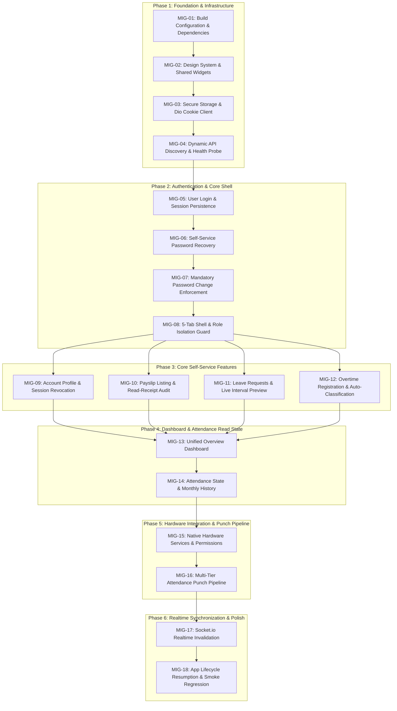

# CORESTAFF MOBILE — FLUTTER MIGRATION ROADMAP & IMPLEMENTATION PLAN

> **Document Version:** 1.0.0  
> **Date:** 2026-11-03  
> **Status:** APPROVED BASELINE — PENDING IMPLEMENTATION AUTHORIZATION  
> **Target Scope:** Incremental, dependency-ordered migration plan for CoreStaff Mobile Flutter.

---

## 1. Architectural Dependency Graph

---

## 2. Recommended Migration Sequencing & Rationale

### Why Attendance is NOT Migrated First
It is a common pitfall in attendance management systems to immediately attempt check-in implementation. In CoreStaff, this approach is strongly discouraged for the following evidence-based reasons:
1. **High Native Hardware Risk:** Attendance check-in relies on three separate native hardware bridges (Wi-Fi BSSID extraction, high-accuracy GPS geofencing, and front-camera photo capture). Attempting this before establishing a verified network client and session storage leads to debugging multiple failure domains simultaneously.
2. **Session Lifespan Constraints:** Attendance punch requests require the HttpOnly `sid` session cookie. Without a stable token refresh engine, testing attendance punches against expired cookies results in ambiguous failures.
3. **Multi-Domain Dependency:** Today's attendance state (`GET /api/attendance/today`) depends on employee assignments, shift templates, approved leave intervals, and pending leave requests.
4. **Optimal Velocity:** Starting with **Foundation → Authentication → Account/Payslips → Leave/Overtime** establishes proven patterns, reusable UI widgets, and stable mock harnesses before tackling the native device layers.

---

## 3. Detailed Step-by-Step Task Breakdown

---

### Task MIG-01: Build Configuration & Dependencies
- **Objective:** Modernize `pubspec.yaml`, add missing enterprise packages, update Android/iOS build configurations, and repair the broken test suite.
- **Source Files to Inspect:**
  - `Apps/mobile/package.json`
  - `Apps/mobile_flutter/pubspec.yaml`
  - `Apps/mobile_flutter/android/app/build.gradle.kts`
  - `Apps/mobile_flutter/test/widget_test.dart`
- **Expected Flutter Target Files:**
  - `Apps/mobile_flutter/pubspec.yaml`
  - `Apps/mobile_flutter/android/app/build.gradle.kts`
  - `Apps/mobile_flutter/android/app/src/main/AndroidManifest.xml`
  - `Apps/mobile_flutter/ios/Runner/Info.plist`
  - `Apps/mobile_flutter/test/widget_test.dart`
- **API Dependencies:** None.
- **Prerequisites:** None.
- **Acceptance Criteria:**
  - `pubspec.yaml` includes: `dio: ^5.4.3`, `flutter_bloc: ^8.1.5`, `get_it: ^7.6.7`, `flutter_secure_storage: ^9.2.2`, `geolocator: ^13.0.1`, `network_info_plus: ^5.0.3`, `image_picker: ^1.1.2`, `permission_handler: ^11.3.1`, `intl: ^0.20.3`, `socket_io_client: ^3.0.1`.
  - Android `minSdk` configured to 23+ (required by geolocator/secure storage); Kotlin JVM target set to 17.
  - Manifests contain declarations for Camera, Location, and Wi-Fi state.
  - `flutter test` executes and passes (obsolete `MyApp` test replaced with dummy sanity check).
- **Automated Tests:** `flutter test` runs with 0 compile errors.
- **Manual Tests:** Build APK in debug mode (`flutter build apk --debug`).
- **Risks:** Gradle plugin version conflicts.
- **Complexity:** Low.

---

### Task MIG-02: Design System & Reusable UI Primitives
- **Objective:** Port reusable UI widgets from React Native (`Apps/mobile/src/components/ui.tsx`) to Flutter to ensure pixel-perfect fidelity with `MOBILE_DESIGN_MASTER.md`.
- **Source Files to Inspect:**
  - `Apps/mobile/src/theme.ts`
  - `Apps/mobile/src/components/ui.tsx`
  - `Apps/mobile/src/components/AppIcon.tsx`
- **Expected Flutter Target Files:**
  - `lib/core/theme/app_colors.dart`
  - `lib/core/theme/app_typography.dart`
  - `lib/core/theme/app_theme.dart`
  - `lib/shared/widgets/app_button.dart`
  - `lib/shared/widgets/app_card.dart`
  - `lib/shared/widgets/app_text_field.dart`
  - `lib/shared/widgets/status_badge.dart`
  - `lib/shared/widgets/banners.dart`
  - `lib/shared/widgets/empty_state.dart`
- **API Dependencies:** None.
- **Prerequisites:** MIG-01.
- **Acceptance Criteria:**
  - `AppButton` supports primary, secondary, and danger styles, loading indicator, and disabled states with min 48px height.
  - `AppCard` supports default and dark themes (`#172554`).
  - `StatusBadge` correctly renders all domain statuses with exact color and background pairings.
  - Touch targets for all interactive controls are at least 44x44px.
- **Automated Tests:** Widget tests in `test/widget/shared/` verifying button tap callbacks, disabled state opacity, and badge color mapping.
- **Manual Tests:** Inspect sample widget gallery on iOS and Android emulators.
- **Risks:** Inconsistent font rendering between platforms.
- **Complexity:** Low.

---

### Task MIG-03: Secure Storage & Dio Cookie Networking Client
- **Objective:** Construct a production-grade Dio HTTP client featuring an encrypted cookie jar and a `QueuedInterceptor` to serialize concurrent requests during 401 token refresh.
- **Source Files to Inspect:**
  - `Apps/mobile/src/auth.ts:46-91`
  - `Apps/api/src/auth/session-cookies.ts`
- **Expected Flutter Target Files:**
  - `lib/core/storage/secure_storage_service.dart`
  - `lib/core/network/cookie_manager.dart`
  - `lib/core/network/auth_interceptor.dart`
  - `lib/core/network/api_client.dart`
  - `lib/core/error/app_exception.dart`
  - `lib/core/error/error_resolver.dart`
- **API Dependencies:** `POST /api/auth/refresh`.
- **Prerequisites:** MIG-01, MIG-02.
- **Acceptance Criteria:**
  - `SecureStorageService` safely persists `sid` and `rt` cookies via Keystore / Keychain.
  - `AuthInterceptor` intercepts HTTP 401 on protected routes, triggers `POST /api/auth/refresh`, updates the stored cookie, and replays buffered calls without dropping requests.
  - Endpoints in `NO_REFRESH_PATHS` are bypassed.
  - Backend errors are parsed into typed `ApiException` instances with Vietnamese translations.
- **Automated Tests:** Unit test with mock HTTP adapter simulating 3 concurrent requests receiving 401, verifying that refresh is called exactly once and all 3 requests are retried.
- **Manual Tests:** Inspect device storage to confirm cookies are encrypted and not stored in plaintext `SharedPreferences`.
- **Risks:** Concurrency deadlock if the refresh call itself throws an unhandled error.
- **Complexity:** High.

---

### Task MIG-04: Dynamic API Discovery & Health Probe
- **Objective:** Implement dynamic base URL resolution with local dev failover and health probing against `/api/healthz`.
- **Source Files to Inspect:**
  - `Apps/mobile/src/config.ts:36-74`
  - `Apps/api/src/health.controller.ts`
- **Expected Flutter Target Files:**
  - `lib/core/config/api_config.dart`
  - `lib/core/network/health_service.dart`
  - `lib/features/splash/presentation/screens/splash_screen.dart`
  - `lib/features/splash/presentation/screens/connection_error_screen.dart`
- **API Dependencies:** `GET /api/healthz`.
- **Prerequisites:** MIG-03.
- **Acceptance Criteria:**
  - Probes remote API (`https://18-141-68-40.sslip.io`) with a 4000ms timeout.
  - In debug mode, falls back to `http://10.0.2.2:3000` (Android) or `http://localhost:3000` (iOS).
  - Validates that `timezone === 'Asia/Ho_Chi_Minh'` and `mongo === 'configured'`.
  - Shows `ConnectionErrorScreen` with retry action if unreachable.
- **Automated Tests:** Unit tests for `ApiConfig.resolveApiBase()` mocking network timeout and fallback success.
- **Manual Tests:** Run app with Wi-Fi disabled to verify error screen; toggle Wi-Fi on and tap "Thử kết nối lại".
- **Risks:** Android emulator network interface misconfiguration.
- **Complexity:** Low.

---

### Task MIG-05: User Login & Session Persistence
- **Objective:** Implement credential login with `LoginDto`, retrieve current identity via `/api/auth/me`, and establish the root authenticated session.
- **Source Files to Inspect:**
  - `Apps/mobile/App.tsx:83-92`
  - `Apps/mobile/src/auth.ts:93-96`
  - `Apps/api/src/auth/auth.controller.ts:20-43`
  - `Apps/api/src/auth/dto/login.dto.ts`
- **Expected Flutter Target Files:**
  - `lib/features/auth/data/models/auth_user_dto.dart`
  - `lib/features/auth/data/auth_repository.dart`
  - `lib/features/auth/presentation/bloc/auth_bloc.dart`
  - `lib/features/auth/presentation/screens/login_screen.dart`
- **API Dependencies:** `POST /api/auth/login`, `GET /api/auth/me`.
- **Prerequisites:** MIG-03, MIG-04.
- **Acceptance Criteria:**
  - Validates identifier and password non-empty before dispatching HTTP request.
  - Successfully parses `Set-Cookie` headers into secure storage.
  - Friendly Vietnamese error mapping for `AUTH_INVALID_CREDENTIALS` and `AUTH_ACCOUNT_LOCKED`.
  - On app launch, checks for existing session and automatically routes to authenticated shell if valid.
- **Automated Tests:** BLoC test for `AuthBloc` verifying `AuthAuthenticated` and `AuthUnauthenticated` state transitions.
- **Manual Tests:** Log in with seeded user (`nv.anphat.01@mailinator.com` / `Demo@123456`). Verify successful entry.
- **Risks:** Session cookie dropped by server due to SameSite/Secure mismatch.
- **Complexity:** Medium.

---

### Task MIG-06: Self-Service Password Recovery
- **Objective:** Implement forgot password email request and reset password token consumption screens.
- **Source Files to Inspect:**
  - `Apps/mobile/App.tsx:94-104`
  - `Apps/mobile/src/auth.ts:100-105`
  - `Apps/api/src/auth/auth.controller.ts:100-130`
- **Expected Flutter Target Files:**
  - `lib/features/auth/presentation/screens/forgot_password_screen.dart`
  - `lib/features/auth/presentation/screens/reset_password_screen.dart`
- **API Dependencies:** `POST /api/auth/forgot-password`, `POST /api/auth/reset-password`.
- **Prerequisites:** MIG-05.
- **Acceptance Criteria:**
  - Validates email format and password confirmation equality locally.
  - Renders success confirmation banner on email dispatch.
  - Friendly error mapping for `AUTH_RESET_TOKEN_INVALID`.
- **Automated Tests:** Widget tests verifying form validation triggers.
- **Manual Tests:** Request reset token; verify transition to token entry screen.
- **Complexity:** Low.

---

### Task MIG-07: Mandatory & Voluntary Password Change
- **Objective:** Implement password update flow enforcing mandatory lockout when `mustChangePassword === true`.
- **Source Files to Inspect:**
  - `Apps/mobile/App.tsx:106-110`
  - `Apps/mobile/src/auth.ts:97-99`
  - `Apps/api/src/auth/auth.controller.ts:97-105`
- **Expected Flutter Target Files:**
  - `lib/features/auth/presentation/screens/change_password_screen.dart`
- **API Dependencies:** `POST /api/auth/change-password`.
- **Prerequisites:** MIG-05.
- **Acceptance Criteria:**
  - If `mustChangePassword === true`, screen cannot be dismissed ("Để sau" button hidden).
  - Validates minimum 8 characters, letters and numbers.
  - Submits `{ currentPassword, newPassword, confirmPassword }`.
  - Friendly error mapping for `AUTH_CURRENT_PASSWORD_INVALID` and `AUTH_PASSWORD_POLICY_FAILED`.
  - On success, updates user state and unlocks navigation.
- **Automated Tests:** Unit test verifying password policy validation logic.
- **Manual Tests:** Test with newly provisioned account flagged with temporary password.
- **Complexity:** Medium.

---

### Task MIG-08: 5-Tab Shell & Role Isolation Guard
- **Objective:** Build the persistent 5-tab application shell with a raised center action button for Attendance, and enforce role blocking for `HR` and `SYSTEM_ADMIN`.
- **Source Files to Inspect:**
  - `Apps/mobile/App.tsx:112-138`
  - `Apps/mobile/src/components/BottomTabBar.tsx`
- **Expected Flutter Target Files:**
  - `lib/features/shell/presentation/screens/main_shell_screen.dart`
  - `lib/features/shell/presentation/screens/unauthorized_role_screen.dart`
  - `lib/features/shell/presentation/widgets/custom_bottom_nav_bar.dart`
- **API Dependencies:** None.
- **Prerequisites:** MIG-05, MIG-07.
- **Acceptance Criteria:**
  - If `user.role === 'HR'` or `'SYSTEM_ADMIN'`, renders `UnauthorizedRoleScreen` with logout button.
  - Renders 5 tabs: Overview, Requests, Attendance (raised center FAB), Payslips, Account.
  - Uses vector icons (`CupertinoIcons` / `Icons`) instead of Unicode characters.
  - Tab state maintained via `IndexedStack` to preserve scroll positions across tab switches.
- **Automated Tests:** Widget test verifying role redirection based on `AuthUser.role`.
- **Manual Tests:** Log in as HR account; verify web redirect screen. Log in as Employee; verify 5-tab navigation.
- **Complexity:** Medium.

---

### Task MIG-09: Account Profile & Session Revocation
- **Objective:** Implement the Account tab, displaying master employee profile details from `/api/hr/employees/me` and handling secure logout.
- **Source Files to Inspect:**
  - `Apps/mobile/src/screens/AccountScreen.tsx`
  - `Apps/mobile/src/employee-api.ts:245-247`
  - `Apps/api/src/hr/employee/employee.controller.ts:104-114`
- **Expected Flutter Target Files:**
  - `lib/features/account/data/models/employee_profile_dto.dart`
  - `lib/features/account/data/account_repository.dart`
  - `lib/features/account/presentation/bloc/account_bloc.dart`
  - `lib/features/account/presentation/screens/account_screen.dart`
- **API Dependencies:** `GET /api/hr/employees/me`, `POST /api/auth/logout`.
- **Prerequisites:** MIG-08.
- **Acceptance Criteria:**
  - Fetches and displays: Full Name, Employee Code, Employment Status badge, Department, Position, Direct Manager, Workplace, Join Date, Email, Phone, Address.
  - Logout action shows confirmation dialog, calls `POST /api/auth/logout`, wipes cookie jar, and resets state to `LoginScreen`.
  - Pull-to-refresh updates profile data.
- **Automated Tests:** BLoC test verifying profile loading and logout events.
- **Manual Tests:** Inspect profile details; execute logout; verify cookies cleared.
- **Complexity:** Low.

---

### Task MIG-10: Payslip Listing & Read-Receipt Audit
- **Objective:** Implement the Payslips tab, rendering net earnings, expandable earning/deduction breakdowns, and auditing viewed status.
- **Source Files to Inspect:**
  - `Apps/mobile/src/screens/PayslipsScreen.tsx`
  - `Apps/mobile/src/employee-api.ts:249-253`
  - `Apps/api/src/hr/payroll/payslip.controller.ts:21-83`
- **Expected Flutter Target Files:**
  - `lib/features/payslip/data/models/payslip_dto.dart`
  - `lib/features/payslip/data/payslip_repository.dart`
  - `lib/features/payslip/presentation/bloc/payslip_bloc.dart`
  - `lib/features/payslip/presentation/screens/payslips_screen.dart`
  - `lib/features/payslip/presentation/widgets/payslip_card.dart`
- **API Dependencies:** `GET /api/payslips/me`, `POST /api/payslips/me/:id/viewed`.
- **Prerequisites:** MIG-08.
- **Acceptance Criteria:**
  - Renders latest period summary in dark highlight card (`netSalary`, `periodLabel`).
  - Lists past payslips with status badge (`Mới` for `RELEASED`, `Đã xem` for `VIEWED`).
  - Tapping unread payslip expands breakdown and fires `POST /api/payslips/me/:id/viewed` silently.
  - Detailed breakdown correctly displays Gross, Insurance, PIT, and Net Pay.
- **Automated Tests:** Unit test verifying money formatting and status badge mapping.
- **Manual Tests:** Open unread payslip; verify status transitions to `VIEWED`.
- **Complexity:** Medium.

---

### Task MIG-11: Leave Requests & Live Working Interval Preview
- **Objective:** Implement leave request listing, debounced working hours preview, and leave submission modal.
- **Source Files to Inspect:**
  - `Apps/mobile/src/screens/RequestsScreen.tsx:54-137`
  - `Apps/mobile/src/employee-api.ts:224-238`
  - `Apps/api/src/hr/leave/leave.controller.ts:13-23`
  - `Apps/api/src/hr/leave/dto/leave.dto.ts`
- **Expected Flutter Target Files:**
  - `lib/features/requests/data/models/leave_request_dto.dart`
  - `lib/features/requests/data/models/leave_preview_dto.dart`
  - `lib/features/requests/data/requests_repository.dart`
  - `lib/features/requests/presentation/bloc/leave_bloc.dart`
  - `lib/features/requests/presentation/widgets/leave_form_modal.dart`
- **API Dependencies:** `GET /api/leave-requests/mine`, `POST /api/leave-requests/preview`, `POST /api/leave-requests`, `POST /api/leave-requests/mine/:id/cancel`.
- **Prerequisites:** MIG-08.
- **Acceptance Criteria:**
  - Supports `PAID_LEAVE` and `UNPAID_LEAVE`.
  - Supports durations: `FULL_DAY`, `MORNING_HALF`, `AFTERNOON_HALF`, `CUSTOM_HOURS`.
  - Debounced (250ms) call to `/api/leave-requests/preview` calculates break deductions and `leaveEquivalent`.
  - Enforces minimum 10-character reason.
  - Allows cancellation of pending requests.
- **Automated Tests:** BLoC test for leave preview calculation and form submission.
- **Manual Tests:** Create half-day morning leave; verify preview shows break subtraction and 0.5 equivalent days.
- **Complexity:** High.

---

### Task MIG-12: Overtime Registration & Auto-Classification
- **Objective:** Implement overtime request creation enforcing schedule non-overlap and retroactive reason rules.
- **Source Files to Inspect:**
  - `Apps/mobile/src/screens/RequestsScreen.tsx:54-137`
  - `Apps/mobile/src/employee-api.ts:239-244`
  - `Apps/api/src/hr/overtime/overtime.controller.ts:19-65`
  - `Apps/api/src/hr/overtime/dto/overtime.dto.ts`
- **Expected Flutter Target Files:**
  - `lib/features/requests/data/models/overtime_request_dto.dart`
  - `lib/features/requests/presentation/bloc/overtime_bloc.dart`
  - `lib/features/requests/presentation/widgets/overtime_form_modal.dart`
  - `lib/features/requests/presentation/screens/requests_screen.dart`
- **API Dependencies:** `GET /api/overtime/mine`, `POST /api/overtime`.
- **Prerequisites:** MIG-11.
- **Acceptance Criteria:**
  - Formats timestamps as ISO-8601 strings with UTC+7 offset.
  - Client strictly DOES NOT submit `overtimeType` (enforces BR-OT-01).
  - Requires `retroactiveReason` if filing for past date.
  - Combines Leave and Overtime lists in unified `RequestsScreen` with segment filters (`Tất cả`, `Nghỉ phép`, `Tăng ca`).
- **Automated Tests:** Unit test verifying ISO timestamp generation and error handling for `OVERTIME_OVERLAPS_SCHEDULE`.
- **Manual Tests:** Submit overtime request; verify presence in list with `PENDING` badge.
- **Complexity:** Medium.

---

### Task MIG-13: Unified Overview Dashboard
- **Objective:** Implement the Overview tab, binding shift metadata and aggregating status badges from attendance, requests, and payslips.
- **Source Files to Inspect:**
  - `Apps/mobile/src/screens/OverviewScreen.tsx`
  - `Apps/mobile/src/employee-api.ts:169-171`
- **Expected Flutter Target Files:**
  - `lib/features/overview/presentation/bloc/overview_bloc.dart`
  - `lib/features/overview/presentation/screens/overview_screen.dart`
  - `lib/features/overview/presentation/widgets/shift_summary_card.dart`
  - `lib/features/overview/presentation/widgets/metric_row.dart`
- **API Dependencies:** `GET /api/attendance/today`, `GET /api/leave-requests/mine`, `GET /api/overtime/mine`, `GET /api/payslips/me`.
- **Prerequisites:** MIG-09, MIG-10, MIG-11, MIG-12.
- **Acceptance Criteria:**
  - Displays user avatar initials and greeting.
  - Shift summary card shows current shift name, hours, workplace, and check-in/out timestamps.
  - Metric counters accurately display pending requests count and unread payslips count.
  - Quick action buttons route directly to target tabs.
- **Automated Tests:** BLoC test verifying concurrent data aggregation across 4 repository calls.
- **Manual Tests:** Verify badge counts match actual unread items in Requests and Payslips tabs.
- **Complexity:** Medium.

---

### Task MIG-14: Attendance State & Monthly History
- **Objective:** Implement the presentation layer for Attendance, including digital clock, daily milestone timeline, working metrics, and monthly history.
- **Source Files to Inspect:**
  - `Apps/mobile/src/screens/AttendanceScreen.tsx`
  - `Apps/mobile/src/employee-api.ts:169-174`
  - `Apps/api/src/attendance/attendance.controller.ts:43-50, 114-121`
- **Expected Flutter Target Files:**
  - `lib/features/attendance/data/models/today_attendance_dto.dart`
  - `lib/features/attendance/data/models/attendance_history_dto.dart`
  - `lib/features/attendance/data/attendance_repository.dart`
  - `lib/features/attendance/presentation/bloc/attendance_bloc.dart`
  - `lib/features/attendance/presentation/screens/attendance_screen.dart`
  - `lib/features/attendance/presentation/widgets/history_card.dart`
- **API Dependencies:** `GET /api/attendance/today`, `GET /api/attendance/history`.
- **Prerequisites:** MIG-13.
- **Acceptance Criteria:**
  - Displays today's shift timeline ("Vào ca" / "Ra ca").
  - Displays working minutes, late minutes, and early departure minutes.
  - Monthly history allows pagination between months (`YYYY-MM`).
  - Action button text reflects state ("Xác nhận vào ca", "Xác nhận ra ca", "Ca làm đã hoàn tất").
- **Automated Tests:** Widget test for timeline point completion state.
- **Manual Tests:** Switch months; verify historical days render with correct badges and minutes.
- **Complexity:** Medium.

---

### Task MIG-15: Native Hardware Services & Permissions
- **Objective:** Implement hardware wrappers for Location, Wi-Fi BSSID extraction, and Camera with unified runtime permission handling.
- **Source Files to Inspect:**
  - `Apps/mobile/src/wifi.ts`
  - `Apps/mobile/src/screens/AttendanceScreen.tsx:15-33`
- **Expected Flutter Target Files:**
  - `lib/core/services/permission_service.dart`
  - `lib/core/services/location_service.dart`
  - `lib/core/services/wifi_service.dart`
  - `lib/core/services/camera_service.dart`
- **API Dependencies:** None.
- **Prerequisites:** MIG-01, MIG-14.
- **Acceptance Criteria:**
  - `PermissionService` requests Camera and Location permissions gracefully, returning descriptive error messages on denial.
  - `WifiService` reads SSID and BSSID, cleans quotation marks, and normalizes MAC to lowercase. Degrades safely to `null` if unavailable.
  - `LocationService` retrieves GPS coordinates with `high` accuracy.
  - `CameraService` captures front-facing photo, compresses to JPEG quality 60, and returns local file path.
- **Automated Tests:** Unit tests for MAC address cleaning and normalization.
- **Manual Tests:** Test camera launch and location acquisition on real Android and iOS devices.
- **Risks:** Platform permission rejection or iOS Wi-Fi entitlement absence.
- **Complexity:** High.

---

### Task MIG-16: Multi-Tier Attendance Punch Pipeline
- **Objective:** Construct the domain `PunchOrchestrator` executing the 3-tier verification sequence (Wi-Fi → GPS → Selfie Multipart) and wire to punch action buttons.
- **Source Files to Inspect:**
  - `Apps/mobile/src/screens/AttendanceScreen.tsx:58-97`
  - `Apps/mobile/src/employee-api.ts:187-222`
  - `Apps/api/src/attendance/attendance.controller.ts:52-111`
  - `Apps/api/src/attendance/dto/check-in.dto.ts`
- **Expected Flutter Target Files:**
  - `lib/features/attendance/domain/punch_orchestrator.dart`
  - `lib/features/attendance/presentation/widgets/punch_action_button.dart`
- **API Dependencies:** `POST /api/attendance/check-in`, `POST /api/attendance/check-out`.
- **Prerequisites:** MIG-14, MIG-15.
- **Acceptance Criteria:**
  - Confirms action via native dialog before execution.
  - Generates UUID `Idempotency-Key` header on every punch attempt.
  - Injects `workMode: 'OUT_OFFICE'` directly to selfie if workplace is remote.
  - For `IN_OFFICE`: attempts BSSID; on `422 SELFIE_REQUIRED`, attempts GPS; on second `422 SELFIE_REQUIRED`, prompts user and captures camera selfie.
  - Sends selfie via Dio `FormData` multipart payload.
  - Refreshes today's attendance state upon successful punch.
- **Automated Tests:** Unit test mocking `PunchOrchestrator` 3-tier cascade and verifying multipart creation.
- **Manual Tests:** Execute check-in inside office Wi-Fi; execute check-in outside office to test selfie fallback; verify event recorded in backend database.
- **Complexity:** High.

---

### Task MIG-17: Socket.io Realtime Invalidation
- **Objective:** Connect to NestJS WebSocket namespace `/events` with session cookies and trigger reactive domain refreshes.
- **Source Files to Inspect:**
  - `Apps/mobile/src/realtime.ts:18-44`
  - `Apps/api/src/events/events.gateway.ts`
- **Expected Flutter Target Files:**
  - `lib/core/network/realtime_service.dart`
- **API Dependencies:** WebSocket `/events` namespace.
- **Prerequisites:** MIG-16.
- **Acceptance Criteria:**
  - Passes `Cookie` header during HTTP handshake before WebSocket upgrade.
  - Listens to: `attendance:changed`, `leave:changed`, `payslip:released`, `request:decided`, `compliance:warning`.
  - Dispatches `RefreshDomainData` events to relevant BLoCs without full page reloads.
  - Automatically reconnects with exponential backoff on connection drops.
- **Automated Tests:** Unit test verifying event subscription and callback dispatch.
- **Manual Tests:** Approve leave request in Web Portal; verify Flutter Requests screen updates badge automatically.
- **Complexity:** Medium.

---

### Task MIG-18: App Lifecycle Resumption & Smoke Regression
- **Objective:** Implement `WidgetsBindingObserver` to re-synchronize active screen data on app resume, and execute full end-to-end regression testing.
- **Source Files to Inspect:**
  - `Apps/mobile/App.tsx:123-128`
- **Expected Flutter Target Files:**
  - `lib/core/services/app_lifecycle_manager.dart`
  - `lib/app.dart`
  - `test/integration/full_regression_smoke_test.dart`
- **API Dependencies:** All Scope A endpoints.
- **Prerequisites:** MIG-01 through MIG-17.
- **Acceptance Criteria:**
  - Resuming app from background triggers silent data reload for active tab.
  - Full smoke test passes covering: Login → Shift Card → Check-in Punch → Leave Submit → Overtime Submit → Payslip View → Profile View → Logout.
  - Memory leak checks and release build compilation (`flutter build apk --release`, `flutter build ipa`).
- **Automated Tests:** Full integration smoke test.
- **Manual Tests:** Execute UAT demo script (An Phat tenant) end-to-end on physical devices.
- **Complexity:** Medium.

---

## 4. Definition of Done (DoD)

A migrated task or feature is considered **DONE** only when it satisfies all five criteria:

1. **Functional Completeness:**
   - All user interactions, form validations, and error scenarios documented in `PROJECT_CONTEXT.md` and `FLUTTER_MIGRATION_AUDIT.md` are implemented.
   - No mock data remains in production code paths.
2. **Technical & Architectural Quality:**
   - Implements Clean Architecture with unidirectional BLoC state flow.
   - All services registered via GetIt; zero global state leaks.
   - Sensitive session cookies stored exclusively in `flutter_secure_storage`.
   - `flutter analyze` passes with **0 warnings** and **0 errors**.
3. **UI / Design Parity:**
   - 100% visual fidelity with `MOBILE_DESIGN_MASTER.md`.
   - Touch targets $\ge 44 \times 44\text{px}$; button heights $\ge 48\text{px}$.
   - All typography, colors, and border radii adhere to design tokens.
4. **API Contract & Compliance:**
   - Complies strictly with backend DTOs and whitelist validation pipes.
   - Timezone arithmetic hardcoded to `Asia/Ho_Chi_Minh` (UTC+7).
   - Generates UUID `Idempotency-Key` headers on mutation endpoints.
5. **Testing & Verification:**
   - Unit and BLoC tests achieve $\ge 80\%$ statement coverage for the module.
   - Verified on both Android and iOS environments.

*(End of Migration Roadmap Specification)*

