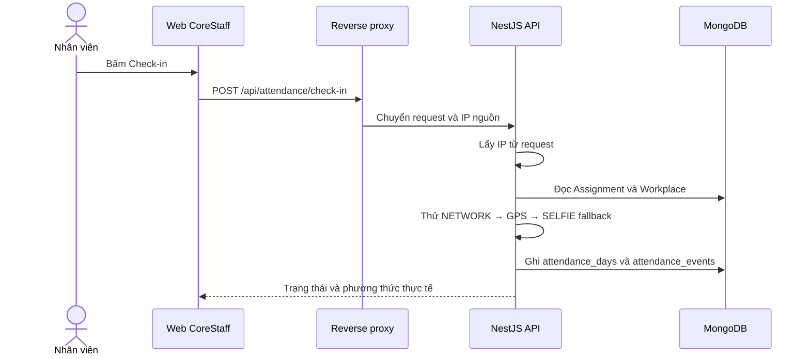

# Check-in bằng WiFi trong CoreStaff

> Trạng thái tài liệu: đã đối chiếu với mã nguồn hiện tại trong `CoreStaff/Apps/api` và `CoreStaff/Apps/web`.
>
> **Kết luận ngắn:** CoreStaff đã có logic nhận diện mạng bằng **IP nguồn của request**, nhưng phần cấu hình mạng tại `Workplace` chưa được nối hoàn chỉnh vào schema/API quản trị. Vì vậy không nên xem tính năng WiFi là đã sẵn sàng cho production.

---

## 1. WiFi trong tài liệu này thực chất là gì?

CoreStaff không kiểm tra tên WiFi (SSID). Hệ thống kiểm tra **địa chỉ IP mà backend nhìn thấy khi nhận request**.

Trong mạng văn phòng, nhiều thiết bị thường cùng đi ra Internet qua một router:

```text
[Điện thoại] 192.168.1.25 ─┐
[Laptop]     192.168.1.30 ─┼─► Router/NAT ─► IP công khai ─► Proxy ─► CoreStaff API
[Máy tính]   192.168.1.40 ─┘                113.161.82.10
```

Backend thường chỉ thấy IP công khai `113.161.82.10`, không thấy IP riêng `192.168.1.x` của từng thiết bị.

> Vì vậy tên gọi chính xác hơn là **chấm công theo IP mạng**, không phải xác minh SSID WiFi.

### Điều backend có thể kết luận

- IP khớp cấu hình nơi làm việc: request đi ra từ mạng đã được cho phép.
- IP không khớp: backend thử phương thức GPS, sau đó có thể yêu cầu Selfie.

### Điều backend không thể kết luận chỉ từ IP

- Người dùng đang kết nối đúng SSID nào.
- Người đang thao tác có thật sự là chủ tài khoản hay không.
- Thiết bị đang ở trong văn phòng nếu người dùng đi qua VPN/proxy có cùng IP đầu ra.

---

## 2. Luồng CoreStaff hiện tại

CoreStaff hỗ trợ ba phương thức ghi nhận tự động: `NETWORK`, `GPS`, `SELFIE` (ngoài ra enum còn có `MANUAL` cho điều chỉnh nghiệp vụ).

### 2.1. Check-in



Thứ tự xử lý trong `AttendanceService.checkIn`:

1. Yêu cầu header `Idempotency-Key`.
2. Kiểm tra người dùng đã check-in trong ngày chưa.
3. Đọc `Assignment`, `Workplace` và ca làm việc.
4. Nếu request có file ảnh, hoặc `workMode = OUT_OFFICE`, xử lý bằng `SELFIE` và chờ quản lý duyệt.
5. Nếu là luồng `IN_OFFICE` không có ảnh:
   - so IP nguồn với `workplace.allowedNetworks`;
   - khớp IP và không tắt chấm công mạng → `NETWORK`;
   - không khớp → thử `GPS` nếu request có tọa độ;
   - không đủ điều kiện GPS → trả `SELFIE_REQUIRED` nếu cho phép fallback, nếu không trả lỗi mạng/vị trí.
6. Ghi thời điểm chính thức bằng giờ server (`recordedAt = new Date()`).
7. Ghi `publicIp`, `userAgent`, phương thức và bằng chứng liên quan vào `attendance_events`.

Check-out dùng lại cùng thứ tự ưu tiên `NETWORK → GPS → SELFIE`, nhưng lấy `workMode` đã lưu từ lúc check-in.

### 2.2. Request thực tế từ web

Web không gửi IP để backend tin tưởng. Với lựa chọn Network, payload tối thiểu hiện tại là:

```http
POST /api/attendance/check-in
Idempotency-Key: <UUID duy nhất>
Content-Type: application/json

{
  "workMode": "IN_OFFICE"
}
```

Check-out theo Network:

```http
POST /api/attendance/check-out
Idempotency-Key: <UUID duy nhất>
Content-Type: application/json

{}
```

Backend tự lấy IP từ request tại `AttendanceController`, sau đó truyền vào `AttendanceService`.

> Lựa chọn `NETWORK` trên giao diện không ép backend ghi nhận bằng Network. `method` cuối cùng do backend quyết định từ dữ liệu thực tế.

---

## 3. Thành phần mã nguồn liên quan

| Thành phần | Vai trò hiện tại |
|---|---|
| `CoreStaff/Apps/api/src/attendance/attendance.controller.ts` | Cung cấp `GET /today`, `POST /check-in`, `POST /check-out`; lấy IP từ request |
| `CoreStaff/Apps/api/src/attendance/attendance.service.ts` | Chọn phương thức `NETWORK → GPS → SELFIE`, ghi ngày công và sự kiện |
| `CoreStaff/Apps/api/src/attendance/services/network-validator.service.ts` | Đọc IP và so khớp IP/CIDR IPv4 |
| `CoreStaff/Apps/api/src/database/schemas/workplace.schema.ts` | Schema Workplace được Attendance module sử dụng |
| `CoreStaff/Apps/api/src/database/schemas/attendance-event.schema.ts` | Lưu `method`, `recordedAt`, `publicIp`, GPS, evidence và user agent |
| `CoreStaff/Apps/web/src/services/attendance.service.ts` | Gọi API và tự tạo `Idempotency-Key` |
| `CoreStaff/Apps/web/src/screens/Attendance/AttendanceScreen.tsx` | Giao diện chọn Network/GPS/Selfie và gửi payload tương ứng |
| `CoreStaff/Apps/web/src/screens/Attendance/verification/useClientIp.ts` | Thử lấy IP LAN bằng WebRTC nhưng hiện không được nơi nào sử dụng |

### Dữ liệu được lưu

- `attendance_days`: trạng thái tổng hợp theo người dùng và ngày làm việc.
- `attendance_events`: tối đa một `CHECK_IN` và một `CHECK_OUT` cho mỗi ngày công; lưu phương thức xác thực và IP nguồn.
- `idempotency_records`: chống xử lý lặp khi client retry cùng một thao tác.
- `evidences` và `manager_requests`: dùng cho luồng Selfie cần quản lý duyệt.

CoreStaff hiện dùng **NestJS + MongoDB/Mongoose**, không dùng Supabase Edge Function/Postgres cho luồng này.

---

## 4. Cách backend đọc và so khớp IP

### 4.1. Trích xuất IP

Logic hiện tại trong `NetworkValidatorService.extractClientIp`:

```ts
const forwarded = req.headers['x-forwarded-for'];
if (forwarded) {
  const forwardedIps = typeof forwarded === 'string' ? forwarded : forwarded[0];
  const clientIp = forwardedIps.split(',')[0].trim();
  if (clientIp) return normalizeIp(clientIp);
}

return normalizeIp(req.socket?.remoteAddress || req.ip || '');
```

Địa chỉ IPv4-mapped IPv6 như `::ffff:192.168.1.5` được chuẩn hóa thành `192.168.1.5`.

### 4.2. Quy tắc mạng dự kiến

Service đang chờ dữ liệu dạng:

```ts
type AllowedNetwork = {
  cidrOrIp: string;
  active?: boolean;
};
```

Ví dụ:

```json
[
  { "cidrOrIp": "113.161.82.10", "active": true },
  { "cidrOrIp": "203.0.113.0/28", "active": true }
]
```

- IP đơn được so khớp chính xác.
- CIDR hiện chỉ hỗ trợ **IPv4**, từ `/0` đến `/32`.
- Rule có `active: false` bị bỏ qua.
- Nếu không có rule hoạt động, kết quả luôn là không khớp.

### 4.3. Cảnh báo về reverse proxy

Code hiện tại tin phần tử đầu tiên của `X-Forwarded-For` mà chưa kiểm tra request có thật sự đi qua proxy tin cậy hay không. Nếu API được truy cập trực tiếp hoặc proxy giữ nguyên header do client gửi, người dùng có thể giả IP.

Trước khi bật production cần chốt một trust boundary rõ ràng:

1. API chỉ nhận traffic từ reverse proxy/load balancer tin cậy.
2. Proxy phải xóa/ghi đè header IP do client tự gửi.
3. Backend phải lấy IP theo cấu hình proxy thực tế, không mặc định tin mọi `X-Forwarded-For`.
4. Có test cho request trực tiếp, một proxy và nhiều proxy.

---

## 5. Khoảng cách giữa thiết kế và hệ thống hiện tại

Đây là các điểm đã xác nhận trực tiếp từ code.

### 5.1. Chưa có cấu hình mạng trong schema Workplace đang dùng

`AttendanceService` đọc các thuộc tính:

- `allowedNetworks`
- `allowNetworkAttendance`
- `allowGpsAttendance`
- `allowSelfieFallback`

Nhưng `CoreStaff/Apps/api/src/database/schemas/workplace.schema.ts` chưa khai báo các thuộc tính này. DTO/API quản trị Workplace cũng chưa cho HR nhập danh sách IP/CIDR.

Ngoài ra repo đang có **hai định nghĩa `WorkplaceSchema`**:

- `src/database/schemas/workplace.schema.ts`
- `src/hr/workplace/workplace.schema.ts`

Schema trong module HR còn ít trường hơn schema trong database. Hai module đăng ký cùng model `Workplace` bằng hai schema khác nhau, tạo nguy cơ đọc/ghi dữ liệu không nhất quán.

**Hệ quả:** với Workplace được tạo qua API hiện tại, `allowedNetworks` thường không tồn tại; nhánh `NETWORK` không thể khớp và backend sẽ chuyển sang GPS/Selfie.

### 5.2. Trạng thái mạng trên web đang hard-code

`AttendanceScreen.tsx` đang tạo `verificationContext` với:

```ts
status: 'CONNECTED_TO_ALLOWED_NETWORK',
canAttend: true,
networkName: 'Mạng văn phòng'
```

`GET /api/attendance/today` không nhận request/IP và không trả kết quả kiểm tra mạng. Do đó trạng thái “đã kết nối mạng cho phép” trên giao diện hiện không phải kết quả xác minh từ backend.

Backend vẫn kiểm tra lại khi `POST /check-in` hoặc `POST /check-out`, nên quyết định ghi công không dựa vào dòng trạng thái hard-code này. Tuy nhiên UX hiện có thể báo sẵn sàng rồi mới trả `SELFIE_REQUIRED` lúc người dùng bấm.

### 5.3. Hook lấy IP ở frontend không tham gia luồng chấm công

`useClientIp.ts` thử tìm **IP LAN** bằng WebRTC và cache 30 phút, nhưng không được import/sử dụng ở màn hình chấm công.

Điều này phù hợp với nguyên tắc bảo mật: frontend không nên gửi một IP tự khai để backend dùng làm căn cứ. File này nên được xóa nếu không dùng cho chẩn đoán, hoặc phải ghi rõ chỉ phục vụ hiển thị/debug.

### 5.4. Chưa hỗ trợ IPv6 CIDR

Hàm so CIDR gọi `ipv4ToNumber`, nên rule IPv6 như `2001:db8::/64` luôn không khớp. Việc chỉ thêm một chuỗi IPv6 vào cấu hình chưa đủ; cần bổ sung bộ phân tích/so khớp IPv6 và test.

### 5.5. Không có QR hoặc ràng buộc thiết bị trong luồng hiện tại

Code hiện tại không yêu cầu token QR, không có bảng/collection `attendance_devices`, không có `MIN_GAP_MS` và không ghi `attendance_rejections` như phiên bản tài liệu cũ từng mô tả.

Cơ chế chống lặp hiện có là `Idempotency-Key` và unique index trên sự kiện check-in/check-out.

---

## 6. Tên WiFi, IP công khai và GPS khác nhau thế nào?

| Cơ chế | Web dùng được | Backend tự xác minh | Tình trạng trong CoreStaff |
|---|---:|---:|---|
| IP nguồn request | Có | Có, nếu proxy được cấu hình an toàn | Có logic, thiếu cấu hình Workplace hoàn chỉnh |
| GPS/geofence | Có, cần người dùng cấp quyền | Không hoàn toàn; tọa độ do client gửi | Đã triển khai |
| Selfie | Có, cần quyền camera | Backend kiểm tra file và tạo yêu cầu duyệt | Đã triển khai |
| SSID/BSSID | Trình duyệt web không có API chuẩn để đọc | Không | Không triển khai |
| QR động | Có thể triển khai | Có thể xác minh token server-side | Không có trong code hiện tại |

SSID là tên do người cài router đặt và có thể bị trùng/giả. BSSID là định danh của access point nhưng trình duyệt web không cung cấp API chuẩn để trang web đọc. Vì vậy hệ thống web không nên thiết kế bảo mật dựa trên việc đọc tên WiFi.

GPS cũng không phải bằng chứng tuyệt đối vì tọa độ đến từ client. Trong CoreStaff, GPS là một phương thức nghiệp vụ được backend kiểm tra khoảng cách và độ chính xác, không phải dữ liệu backend tự quan sát như IP nguồn.

---

## 7. Rủi ro vận hành

| Rủi ro | Hệ quả | Cách xử lý đề xuất |
|---|---|---|
| IP công ty là IP động | Rule hết hiệu lực khi nhà mạng đổi IP | Thuê IP tĩnh hoặc có quy trình cập nhật được kiểm soát |
| CGNAT/IP dùng chung | Địa điểm khác có thể có cùng IP đầu ra | Dùng IP tĩnh riêng; kết hợp GPS/Selfie/QR tùy chính sách |
| VPN/proxy công ty | Người ở ngoài văn phòng vẫn có IP hợp lệ | Chốt rõ có cho phép VPN hay không; tách IP VPN khỏi IP văn phòng |
| Giả `X-Forwarded-For` | Bỏ qua kiểm tra mạng | Chỉ tin proxy xác định và chặn truy cập trực tiếp API |
| IPv6 | Người dùng hợp lệ bị chuyển sang fallback | Hỗ trợ IPv6 đầy đủ hoặc bảo đảm egress IPv4 trong phạm vi triển khai |
| Frontend hard-code trạng thái hợp lệ | Giao diện báo sai trước khi submit | Thêm endpoint backend kiểm tra network readiness hoặc bỏ nhãn khẳng định |
| Chỉ dựa vào IP | Không chống chấm công hộ/VPN | Kết hợp thêm bằng chứng phù hợp với mức rủi ro |

---

## 8. Checklist để hoàn thiện tính năng

### Bắt buộc trước production

- [ ] Hợp nhất còn một `WorkplaceSchema` dùng chung cho Attendance và HR.
- [ ] Thêm `allowedNetworks`, `allowNetworkAttendance`, `allowGpsAttendance`, `allowSelfieFallback` vào schema và DTO quản trị.
- [ ] Validate từng IP/CIDR khi tạo hoặc cập nhật Workplace; không nhận chuỗi sai định dạng.
- [ ] Xác định reverse proxy/load balancer production và sửa cách lấy IP theo trust boundary đó.
- [ ] Chặn đường truy cập trực tiếp bỏ qua proxy.
- [ ] Không hard-code `CONNECTED_TO_ALLOWED_NETWORK` và `canAttend: true` ở frontend.
- [ ] Thêm integration test cho IP hợp lệ, IP không hợp lệ, rule inactive và header giả.
- [ ] Chốt chính sách IPv6 và VPN.

### Nên làm

- [ ] Trả `networkStatus` từ backend nếu UI cần hiển thị trạng thái trước khi bấm.
- [ ] Audit log khi HR thay đổi danh sách mạng.
- [ ] Không trả nguyên danh sách IP/CIDR cho role Employee nếu không cần thiết.
- [ ] Xóa `useClientIp.ts` hoặc giới hạn nó vào màn hình chẩn đoán dành cho admin.
- [ ] Thêm metrics cho tỷ lệ `NETWORK`, `GPS`, `SELFIE_REQUIRED` để phát hiện cấu hình hỏng.

---

## 9. Tóm tắt

1. CoreStaff xác minh mạng bằng IP nguồn request, không đọc tên WiFi.
2. Backend ưu tiên `NETWORK`, sau đó `GPS`, cuối cùng là Selfie fallback.
3. Thời gian chính thức và phương thức chấm công do backend ghi vào MongoDB.
4. Phần so khớp IPv4 đã có, nhưng schema/API cấu hình mạng của Workplace chưa hoàn chỉnh.
5. Cần sửa trust proxy và trạng thái hard-code trên frontend trước khi xem đây là cơ chế production an toàn.