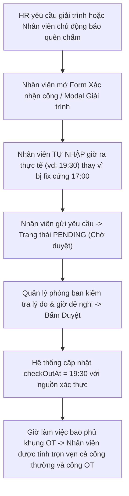

# Kế hoạch triển khai: Tính năng Phản hồi Giải trình công cho Nhân viên & Tối ưu Xác nhận công / OT

## 1. Mục tiêu & Định hướng đã thống nhất

Theo kết quả khảo sát phương án giải quyết:
1. **Vị trí thông báo**: Hiển thị **Banner cảnh báo nổi bật** trên đầu trang Chấm công (`AttendanceScreen`), trang Tăng ca & Yêu cầu (`LeaveOvertimeScreen`), đồng thời ghim thông báo/nút giải trình trực tiếp tại ngày tương ứng trong **Lịch sử chấm công** (`AttendanceHistoryView`).
2. **Nút thao tác & Modal giải trình**: Thêm nút **"Giải trình ngay"** ngay trên thẻ yêu cầu có trạng thái `Cần giải trình` trong danh sách "Yêu cầu gần đây". Khi bấm sẽ mở Modal chuyên biệt hiển thị lời nhắn của HR, mốc giờ thiếu, form nhập lý do giải trình và giờ thực tế đề nghị.
3. **Tên nhãn hiển thị**: Cập nhật nhãn từ *"Điều chỉnh công (cũ)"* sang **"Xác nhận công (Giải trình)"** (dựa vào `source: 'HR_MISSING_PUNCH_EXPLANATION'`).
4. **Luồng xử lý dữ liệu**: Khi nhân viên gửi giải trình, đơn chuyển sang trạng thái **`PENDING` (Chờ duyệt)** và ngày công chuyển sang **`PENDING_APPROVAL`** để Quản lý phòng ban kiểm tra, xác nhận và bổ sung công vào kỳ công.
5. **Cấu hình hạn mức xác nhận công (Hạn mức 3/3 lượt)**:
   - Hiện tại con số 3 lượt/tháng nằm trong Chính sách tuân thủ lao động (`LaborCompliancePolicy.maxMonthlyAttendanceConfirmations`).
   - Sẽ đưa trường cấu hình này hiển thị trực tiếp trong màn hình **Chính sách quy đổi ngày công** (`WorkCreditPolicyScreen`) để HR có thể dễ dàng quản lý, tùy chỉnh hạn mức theo tháng (hoặc để 0 để khóa, hoặc tăng số lượt tùy theo quy định công ty).
6. **Xử lý quên check-out khi có làm thêm giờ (OT)**:
   - **Bản chất vấn đề cũ**: Form xác nhận công cũ fix cứng giờ ra về của công ty (17:00), dẫn đến hệ thống OT V2 không có dữ liệu rời công ty thực tế sau 17:00, làm nhân viên bị mất quyền lợi giờ tăng ca.
   - **Giải pháp thống nhất**: Thay vì fix cứng 17:00, hệ thống **cho phép nhân viên tự nhập giờ ra thực tế** (ví dụ: 19:30) kèm lý do trong đơn Xác nhận công / Giải trình. Khi Quản lý phòng ban xem xét và bấm duyệt, hệ thống sẽ ghi nhận mốc ra thực tế này và cho phép tính đủ giờ OT cho nhân viên.

---

## 2. Kiến trúc & Các thành phần kỹ thuật cần chỉnh sửa



---

## 2.5. Kết quả QC — Rủi ro phát hiện (2026-11-03)

> QC dựa trên phân tích mã nguồn thực tế. **5 blocker phải fix trước khi viết code mới.**

### 🔴 Blocker (B)

| ID | Vấn đề | File | Tác động |
|----|--------|------|----------|
| **B-1** | `CONFIRMED_ACTUAL` chưa có trong enum `AttendanceEndpointSource` | `attendance-day.schema.ts:13-18` | Mongoose reject document khi save provenance mới |
| **B-2** | `assertVerifiedAttendance()` chỉ accept `OBSERVED`, sẽ block OT từ đơn giải trình | `overtime.service.ts:933` | OT không được tính dù đã duyệt |
| **B-3** | `decide()` trong `AttendanceConfirmationService` filter `confirmationSlotActive:true` — không match đơn giải trình | `attendance-confirmation.service.ts:48` | Duyệt đơn giải trình sẽ throw `REQUEST_STATE_CHANGED` |
| **B-4** | `managerRequestKind()` không có case cho `HR_MISSING_PUNCH_EXPLANATION` → hiển thị "Điều chỉnh công (cũ)" | `manager.service.ts:159-168` | Sai nhãn, giao diện nhân viên không biết đây là đơn giải trình |
| **B-5** | `RespondClarificationDto` chưa được định nghĩa, endpoint chưa có | `manager.controller.ts` | Endpoint không thể triển khai |

### 🟡 Rủi ro kỹ thuật (R)

| ID | Vấn đề | Giải pháp |
|----|--------|-----------|
| **R-1** | Race condition `respondClarification` không có transaction | Bọc trong `session.withTransaction()` với version check |
| **R-2** | Chưa rõ đơn giải trình có tiêu slot quota không | **Quyết định: Không tiêu slot** — luồng HR chủ động, khác với nhân viên xác nhận |
| **R-3** | `customCheckOutTime` không có timezone → parse sai 7 tiếng | FE join `workDate + HH:mm + "+07:00"` trước khi gửi |
| **R-4** | `respondClarification` thiếu period CLOSED guard | Copy guard từ `createMine()` line 68 |
| **R-5** | Không có idempotency cho lần gửi giải trình — double submit | BE: version check; FE: `busy` state disable button |
| **R-6** | `contextHash` không còn ý nghĩa trong luồng giải trình | Skip hash check trong `respondClarification` |

### 🟠 Gap logic (G)

| ID | Vấn đề | Sửa plan |
|----|--------|----------|
| **G-1** | Quota `maxMonthlyAttendanceConfirmations` nằm trong `LaborCompliancePolicy`, không phải `WorkCreditPolicy` | Sửa thành: đưa cấu hình vào `LaborCompliancePolicyScreen` |
| **G-2** | Nhãn "Ý kiến Quản lý" chưa phân biệt với "Yêu cầu từ HR" | Thêm logic phân biệt theo `source` |
| **G-3** | Manager UI chưa hiển thị `requestedEnd` (giờ đề nghị của nhân viên) | Thêm vào plan Giai đoạn 3 |
| **G-4** | Giai đoạn 5 thiếu 6 test case quan trọng | Xem bảng trong báo cáo QC đầy đủ |
| **G-5** | `CONFIRMED_ACTUAL` enum cần grep toàn project sau khi thêm | Bước pre-flight bắt buộc |

---

## 3. Chi tiết triển khai theo từng giai đoạn

### Giai đoạn 1: Backend API tiếp nhận giải trình & hỗ trợ tự nhập giờ ra thực tế
- **File**: `CoreStaff/Apps/api/src/hr/manager/manager-request.service.ts`
  - Thêm phương thức `respondClarification(organizationId: string, userId: string, requestId: string, payload: RespondClarificationDto)`:
    - Kiểm tra đơn tồn tại, thuộc `organizationId`, và `employeeUserId == userId`.
    - Kiểm tra trạng thái hiện tại phải là `CLARIFICATION_REQUESTED`.
    - Cập nhật thông tin giải trình của nhân viên:
      + `reason`: bổ sung hoặc cập nhật lý do nhân viên giải trình.
      + `status`: chuyển về `'PENDING'`.
      + `requestedStart` / `requestedEnd` / `proposedChanges`: lưu mốc giờ thực tế nhân viên tự đề nghị bổ sung.
      + Cập nhật `attendance_days.overallApprovalStatus = 'PENDING_APPROVAL'`.
      + Tăng `periodVersionService.bump()`.
- **File**: `CoreStaff/Apps/api/src/hr/manager/attendance-confirmation.service.ts`:
  - Hỗ trợ tham số `customCheckOutTime` / `customCheckInTime` khi nhân viên gửi đơn Xác nhận công (nếu nhân viên tự nhập giờ ra khác với giờ kết thúc ca danh định).
  - Khi Quản lý duyệt, ghi nhận `checkOutAt` theo giờ nhân viên tự nhập và gắn `provenance: { source: 'CONFIRMED_ACTUAL', requestId }`.
  - Cập nhật điều kiện xác minh trong `overtime.service.ts` (`assertVerifiedAttendance`): Chấp nhận cả nguồn mốc được Quản lý duyệt hợp lệ (`CONFIRMED_ACTUAL` hoặc `MANUAL_ADJUSTMENT`) để tính OT cho nhân viên khi đã có sự phê duyệt của Quản lý.
- **File**: `CoreStaff/Apps/api/src/hr/manager/manager.controller.ts`:
  - Thêm endpoint:
    ```ts
    @Roles('EMPLOYEE', 'DEPARTMENT_MANAGER')
    @Post('requests/:id/respond-clarification')
    async respondClarification(
      @Tenant() org: string | null,
      @CurrentUser() user: SessionUser,
      @Param('id') id: string,
      @Body() dto: RespondClarificationDto,
    )
    ```

---

### Giai đoạn 2: Cập nhật Service, Mapping nhãn & Đồng bộ Cấu hình Quota
- **File**: `CoreStaff/Apps/web/src/services/manager.service.ts`:
  - Cập nhật `managerRequestKind`:
    ```ts
    if (request.source === 'HR_MISSING_PUNCH_EXPLANATION') return 'CLARIFICATION';
    ```
  - Cập nhật `managerRequestLabel`:
    ```ts
    export const managerRequestLabel = (request: ManagerRequest) => ({
      OVERTIME: 'Làm thêm giờ (OT)',
      CONFIRMATION: 'Xác nhận công theo lịch',
      SELFIE: 'Chấm công Selfie',
      CLARIFICATION: 'Xác nhận công (Giải trình)',
      MANUAL: 'Điều chỉnh công (cũ)',
    }[managerRequestKind(request)]);
    ```
  - Thêm API call `respondRequestClarification`.
- **Cấu hình Quota 3/3 lượt**:
  - Tích hợp trường `maxMonthlyAttendanceConfirmations` vào trang **Chính sách quy đổi ngày công** (`WorkCreditPolicyScreen`) hoặc liên kết đồng bộ, cho phép HR chỉnh sửa trực tiếp số lượt xác nhận công cho phép trong tháng (ví dụ: 3, 5, hoặc 10 lượt/tháng).

---

### Giai đoạn 3: Cho phép Nhân viên tự nhập giờ ra trong Form & Modal Giải trình
- **File**: `CoreStaff/Apps/web/src/screens/Employee/AttendanceConfirmationForm.tsx`:
  - Thay vì chỉ hiển thị cố định giờ tan ca (17:00), bổ sung tùy chọn / input cho phép nhân viên **chỉnh sửa giờ ra thực tế** nếu hôm đó có làm thêm giờ.
  - Gợi ý hướng dẫn rõ ràng: *"Nếu hôm nay bạn có làm việc ngoài giờ (OT), vui lòng nhập giờ ra thực tế để làm căn cứ tính OT sau khi quản lý phê duyệt."*
- **File mới**: `CoreStaff/Apps/web/src/screens/Employee/components/ClarificationResponseModal.tsx`:
  - Header: Tiêu đề "Phản hồi giải trình chấm công", hiển thị ngày làm việc và lời nhắn từ HR (`request.reason` hoặc `request.reviewComment`).
  - Body:
    - Cho phép nhân viên tự nhập mốc giờ vào/ra thực tế (`Input type="time"`).
    - Textarea lý do giải trình (validation $\ge 10$ ký tự).
  - Footer: Nút Hủy và nút "Gửi giải trình cho Quản lý".
- **File**: `CoreStaff/Apps/web/src/screens/Employee/EmployeeWorkScreens.tsx`:
  - Danh sách "Yêu cầu gần đây": Nếu trạng thái là `CLARIFICATION_REQUESTED`, hiển thị nút **"Giải trình ngay"** mở `ClarificationResponseModal`.

---

### Giai đoạn 4: Hệ thống Banner cảnh báo toàn diện
- **Trang Tăng ca & Xác nhận công (`LeaveOvertimeScreen`)**:
  - Hiển thị Banner cảnh báo màu vàng cam ghim trên đầu trang:
    > ⚠️ **Bạn có {count} yêu cầu cần giải trình từ HR / Quản lý:** Vui lòng gửi giải trình sớm để quản lý kịp thời chốt kỳ công. `[Xem và giải trình ngay]`
- **Trang Chấm công chính (`AttendanceScreen`)**:
  - Hiển thị Alert Banner trên đầu trang khi nhân viên vào chấm công hàng ngày nếu có đơn cần giải trình.
- **Trang Lịch sử chấm công (`AttendanceHistoryView` & `DayDetailModal`)**:
  - Tại ô ngày có trạng thái `CLARIFICATION_REQUESTED` (như ngày 21/10): hiển thị chấm cam / badge `Cần giải trình`.
  - Trong `DayDetailModal`: Hiển thị khung lời nhắn từ HR cùng nút **"Giải trình ngay"** mở trực tiếp modal phản hồi.

---

### Giai đoạn 5: Kiểm thử tự động & Xác minh chất lượng
- **Unit test Backend**:
  - Kiểm tra gửi giải trình với giờ ra tùy chỉnh (vd: 19:30).
  - Kiểm tra Quản lý duyệt mốc ra tùy chỉnh $\rightarrow$ hệ thống tính đủ cả công thường và OT.
  - Kiểm tra cập nhật hạn mức xác nhận công thành công.
- **Unit test Frontend**:
  - Kiểm tra hiển thị nhãn `"Xác nhận công (Giải trình)"`.
  - Kiểm tra form cho phép tự nhập giờ ra thực tế và validate hợp lệ.
  - Kiểm tra hiển thị Banner cảnh báo khi có đơn chờ giải trình.
- Chạy `npm run build` trên cả `@corestaff/api` và `@corestaff/web`.
