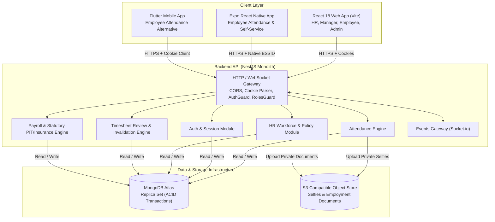
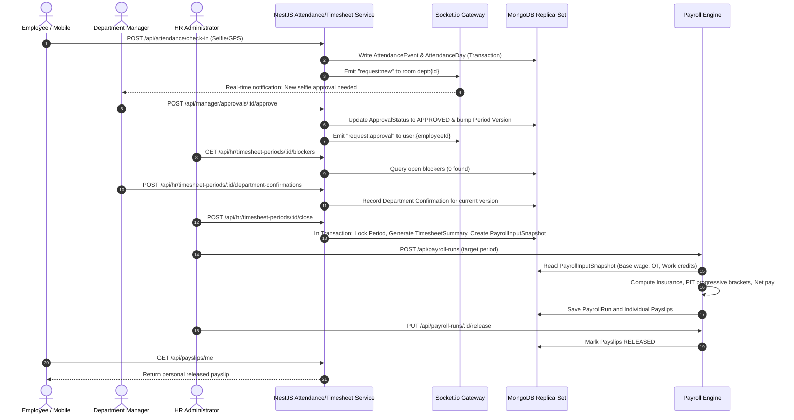
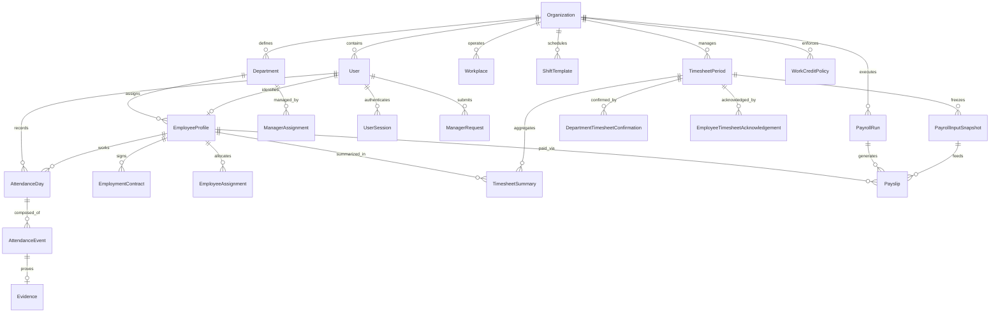
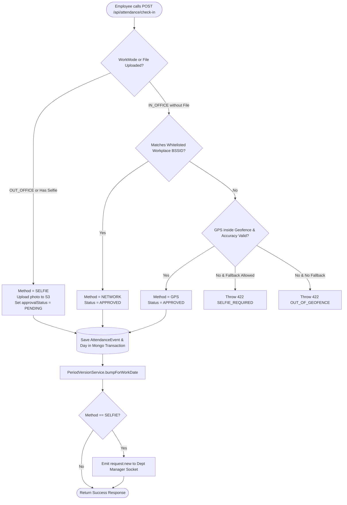
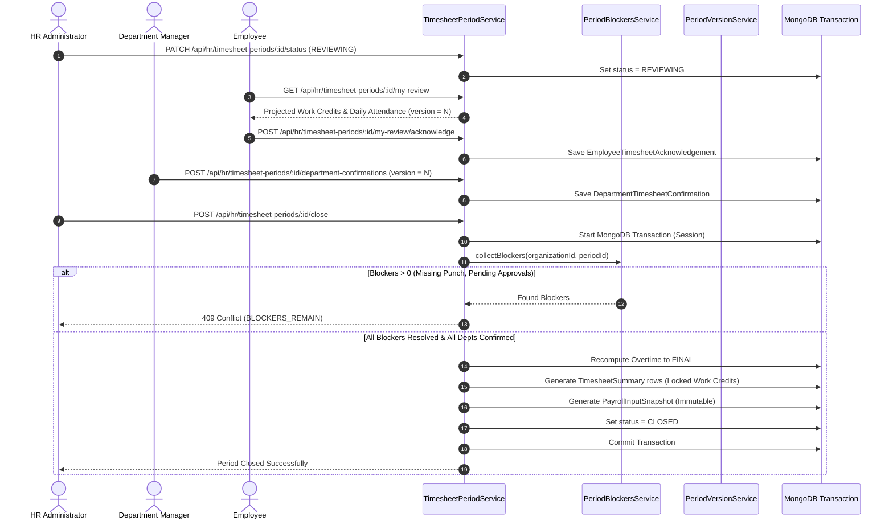

# PROJECT_CONTEXT.md

## 1. Executive Summary

- **Project Name:** CoreStaff — Human Resource, Attendance & Payroll Management System (Hệ thống Quản trị Nhân sự, Chấm công và Tiền lương).
- **Project Purpose & Problem Solved:** Small-to-medium organizations (specifically targeted at 10–50 employees per tenant) frequently struggle with fragmented HR operations, attendance fraud (buddy punching, spoofed GPS), unverified overtime, manual leave tracking, and error-prone monthly timesheet-to-payroll calculations. CoreStaff provides an integrated, multi-tenant enterprise solution that links attendance verification (Wi-Fi BSSID matching, GPS geofencing with accuracy thresholds, and photo selfie approval) to formal work credit evaluation, manager approvals, immutable timesheet snapshots, and automated statutory payroll runs under Vietnamese labor law (BHXH, BHYT, BHTN, progressive PIT).
- **Target Users & Personas:**
  - `SYSTEM_ADMIN`: Platform administrator managing tenant provisioning, subscription lifecycle, and initial HR onboarding. Does not manage tenant operational data.
  - `HR`: Tenant administrator configuring workforce organizational structures, shifts, workplaces, holidays, compensation catalogs, and executing timesheet closure and payroll calculations.
  - `DEPARTMENT_MANAGER`: Operational supervisor reviewing daily punch exceptions, approving selfie check-ins and overtime, evaluating KPI scores, and confirming department timesheets.
  - `EMPLOYEE`: Field or office worker executing check-ins/outs, viewing daily status, submitting leave and OT requests, acknowledging timesheet drafts, and reviewing personal payslips.
- **Main Capabilities:**
  - Strict tenant isolation across all collections using `organizationId`.
  - Multi-factor attendance verification (Network Wi-Fi BSSID, GPS Geofencing via Haversine distance, and Selfie with manager approval).
  - Effective-dated policies for labor compliance, overtime multipliers, work credits, and insurance profiles.
  - Timesheet review lifecycle (`OPEN` → `REVIEWING` → `READY_TO_CLOSE` → `LOCKED` / `CLOSED`) with blocker reconciliation, department confirmations, employee acknowledgements, and optimistic versioning.
  - End-to-end statutory payroll engine supporting base wage prorating, non-taxable vs taxable allowances, progressive Personal Income Tax (PIT), and employee/employer insurance contributions.
  - Real-time updates via Socket.io WebSockets (`/events` namespace).
  - Monorepo containing NestJS backend, React Vite web application, Expo React Native employee mobile app, and a companion Flutter mobile application.
- **High-Level Architecture:** Monorepo with a NestJS REST API connected to MongoDB Atlas (replica set required for multi-document ACID transactions), serving a single-page React 18 web application, an Expo React Native mobile client, and a Flutter mobile client. Private documents and selfies are securely stored via an S3-compatible object store abstraction.
- **Current Development Status:** Core backend modules (Auth, HR Core, Attendance, Leave, Overtime, Timesheet, and Payroll) are fully implemented with comprehensive unit and integration test suites. The Web MVP is functionally complete for all four personas. A complete historical and live demo scenario (An Phat Corporation - tenant `ANPHAT`) is implemented via virtual-clock seeders. Mobile apps (React Native and Flutter) have UI shells, authentication, and core employee screens implemented.

---

## 2. Project Scope & Requirements

### 2.1. Functional Requirements

- **Tenant Management (FR-SYS):**
  - Provision and suspend/activate tenant organizations (`Organization`).
  - Bootstrap initial HR tenant accounts with generated temporary credentials (`PLATFORM_ADMIN`).
  - Global uniqueness of tenant `code` and platform-wide administrative bypass.
- **Identity & Access Management (FR-AUTH):**
  - Tenant-scoped login using normalized email (`emailN`) or employee code (`employeeCode`).
  - Dual-token session model using HttpOnly cookies: short-lived session cookie (`sid`, 30 min idle TTL) and long-lived refresh cookie (`rt`, 14-day TTL).
  - SHA-256 session token hashing (`UserSession.tokenHash`); plaintext tokens are never persisted in the database.
  - Account lockout after consecutive failed attempts (5 attempts, progressive lockout window).
  - Mandatory password change enforcement (`mustChangePassword: true`) blocking all non-whitelisted routes with `403 AUTH_PASSWORD_CHANGE_REQUIRED`.
- **HR Workforce & Policy Configuration (FR-HR):**
  - Organizational catalogs: Departments (`Department`), Job Positions (`Position`), Workplaces (`Workplace` with lat/long, allowed radius, Wi-Fi BSSID whitelist).
  - Full-time shift templates (`ShiftTemplate`) defining start time, end time, and break intervals (no overnight shifts supported in MVP).
  - Employee master records (`EmployeeProfile`), employment contracts (`EmploymentContract` with DRAFT/ACTIVE/EXPIRED/TERMINATED states and 30-day expiry notifications), and encrypted/private document attachments (`EmployeeDocument`).
  - Effective-dated policies: `SalaryProfile`, `LaborCompliancePolicy`, `OvertimePayPolicy`, `WorkCreditPolicy`, `TaxPolicy`, and `InsurancePolicy`.
- **Attendance & Time Tracking (FR-ATT):**
  - Daily punch evaluation (`AttendanceDay`) supporting `IN_OFFICE` and `OUT_OFFICE` modes.
  - Multi-tier verification pipeline:
    1. Selfie capture (`SELFIE`) required if `OUT_OFFICE` or photo uploaded (triggers `ManagerRequest` approval queue).
    2. Wi-Fi BSSID matching (`NETWORK`) against workplace authorized access points.
    3. GPS geofence distance calculation (`GPS`) using Haversine formula with maximum accuracy filter (`accuracyMeters <= maximumAccuracyMeters`).
  - Automatic computation of working minutes, late arrivals, and early departures after deducting lunch break intervals.
  - Real-time punch dispatching to managers via WebSockets.
- **Leave & Overtime Management (FR-LV / FR-OT):**
  - Leave requests (`LeaveRequest`) supporting `FULL_DAY`, `MORNING_HALF`, `AFTERNOON_HALF`, and `CUSTOM_HOURS`.
  - Multi-step leave workflow: Employee submits → Department Manager approves/rejects → HR applies to attendance calendar (`EmployeeDayOverride`).
  - Overtime requests (`OvertimeRequest`) with backend-enforced type classification (`NORMAL_DAY`, `WEEKLY_OFF`, `PUBLIC_HOLIDAY`) verified against `CalendarException`.
  - Daily/weekly/monthly overtime threshold enforcement against `LaborCompliancePolicy`.
- **Timesheet Review & Closing (FR-TS):**
  - Monthly periods (`TimesheetPeriod`) with optimistic concurrency versioning (`version`).
  - Blocker detection (`PeriodBlockersService`): missing check-in/check-out, pending approvals, clarification requests, and unhandled absences prevent closing.
  - Department manager timesheet confirmation (`DepartmentTimesheetConfirmation`) and employee self-service acknowledgement (`EmployeeTimesheetAcknowledgement`).
  - Any upstream source mutation (punch, approval, leave apply, policy change) automatically invalidates active period versions via `PeriodVersionService`.
  - Atomic period closing (`hrClosePeriod`): executes under a MongoDB transaction, locks period, finalizes overtime, generates immutable `TimesheetSummary` rows, and freezes `PayrollInputSnapshot`.
- **Statutory Payroll & Payslip (FR-PAY):**
  - Payroll run lifecycle (`PayrollRun`): `DRAFT` → `CALCULATING` → `CALCULATED` → `LOCKED` → `RELEASED`.
  - Base salary prorating against standard working days derived from `WorkCreditPolicy` work units.
  - Calculation of non-taxable allowances, attendance bonuses, and KPI incentives.
  - Statutory employee deductions: BHXH (8%), BHYT (1.5%), BHTN (1%) with statutory maximum caps.
  - Progressive personal income tax calculation across 7 statutory brackets, factoring in self deductions (11M VND standard / 15.5M VND updated) and dependent deductions (4.4M VND / 6.2M VND per dependent).
  - Personal payslip generation (`Payslip`) with strict employee self-view privacy and Excel export.

### 2.2. Non-Functional Requirements

- **Tenant Isolation:** Zero IDOR leakage. Every operational database query MUST be filtered by `organizationId`.
- **Transaction Safety:** Financial and attendance state transitions MUST use MongoDB multi-document ACID transactions on a replica set cluster.
- **Security & Privacy:** Sensitive configurations (passwords, connection strings, S3 secrets) must never be logged or returned in API responses. Session tokens must be hashed with SHA-256 before persistence.
- **Auditability:** Immutability for financial snapshots (`PayrollInputSnapshot`, `TimesheetSummary`), change logs on policies, and audit records on period reopening.
- **Timezone Integrity:** Hardcoded to `Asia/Ho_Chi_Minh` (UTC+7) across all date-only arithmetic and punch boundary validations.

### 2.3. User Roles & Capabilities

| Role | Operational Scope | Core Capabilities |
|---|---|---|
| `SYSTEM_ADMIN` | Platform-wide | Manage organizations, activate/suspend tenants, create initial HR, view audit logs. Bypasses tenant checks on platform endpoints. |
| `HR` | Tenant-wide | Manage departments, employees, contracts, policies, calendars; review timesheet blockers; execute period closure and payroll runs. |
| `DEPARTMENT_MANAGER` | Department(s) assigned via `ManagerAssignment` | Review & approve/reject selfies and OT; confirm department monthly timesheets; evaluate employee KPI scores; punch personal attendance. |
| `EMPLOYEE` | Personal self-service | Punch check-in/out; submit leave and OT requests; review attendance history; acknowledge timesheet drafts; inspect personal payslips. |

### 2.4. In-Scope vs Out-of-Scope (SRS Baseline)

- **In-Scope (MVP Baseline):**
  - Full-time administrative office schedule (`FULL_TIME`, fixed daytime hours).
  - Multi-tenant data segregation.
  - Network, GPS, and Selfie attendance validation.
  - Timesheet blocker resolution and department confirmation flow.
  - Vietnamese statutory payroll, insurance, and PIT calculation.
  - React Web application and Expo Mobile application.
- **Out-of-Scope (Deferred / Non-MVP):**
  - Part-time schedules, shift swaps, rotating shifts, and overnight cross-midnight shifts.
  - AI facial recognition, liveness detection, or biometric fingerprint hardware integration.
  - Direct banking payment gateway integration and automatic annual tax finalization.
  - Continuous background GPS tracking and offline attendance punch synchronization.
  - Public self-registration, billing, and subscription invoicing.

---

## 3. Technology Stack

| Layer | Technology | Version | Responsibility | Evidence |
|---|---|---|---|---|
| **Backend Runtime** | Node.js | `>=20.0.0` (CI uses `22`) | Server execution environment | `CoreStaff/package.json:23`, `.github/workflows/ci.yml:16` |
| **Backend Framework** | NestJS | `^11.0.0` | Modular REST API framework, dependency injection, validation pipes | `CoreStaff/Apps/api/package.json:72-76` |
| **Database Engine** | MongoDB (Atlas Replica Set) | Server `>=6.0` (Mongoose `^8.9.0`) | Primary multi-tenant document store with multi-document ACID transactions | `CoreStaff/Apps/api/package.json:87`, `Docs/DOCS_DECISION_LOG.md:D29` |
| **Realtime Messaging** | Socket.io / NestJS WebSockets | `^4.8.1` / `^11.0.0` | Real-time notifications for manager approvals and requests | `CoreStaff/Apps/api/package.json:77-79,90` |
| **Object Storage** | AWS S3 SDK | `^3.1135.0` | Secure document and selfie evidence storage abstraction | `CoreStaff/Apps/api/package.json:71` |
| **Excel Export** | ExcelJS | `^4.4.0` | Exporting payroll runs and timesheet summaries to spreadsheet | `CoreStaff/Apps/api/package.json:84` |
| **Web Frontend** | React | `^18.3.1` | User interface for HR, Admin, Manager, and Employee | `CoreStaff/Apps/web/package.json:21` |
| **Web Build Tool** | Vite | `^5.4.11` | Rapid development server and production bundler | `CoreStaff/Apps/web/package.json:37` |
| **Web Styling** | TailwindCSS | `^4.3.3` | Utility-first responsive styling | `CoreStaff/Apps/web/package.json:35` |
| **Web UI Components** | Base UI / Lucide React | `^1.8.0` / `^1.46.0` | Headless accessible components and UI icons | `CoreStaff/Apps/web/package.json:16,20` |
| **Mobile Frontend (Primary)** | React Native / Expo | RN `0.86.3` / Expo `~57.0.23` | Employee mobile application (dev client with native Wi-Fi module) | `CoreStaff/Apps/mobile/package.json:10,19` |
| **Mobile Native Wi-Fi** | react-native-network-info | `^5.2.2` | Reading hardware BSSID for Wi-Fi attendance validation | `CoreStaff/Apps/mobile/package.json:20` |
| **Mobile Frontend (Alt)** | Flutter | SDK `^3.13.1` | Native mobile cross-platform alternative | `CoreStaff/Apps/mobile_flutter/pubspec.yaml:22` |
| **Testing (Backend)** | Jest / ts-jest / Supertest | `^29.7.0` / `^29.2.5` | Unit and integration testing with in-memory replica set | `CoreStaff/Apps/api/package.json:103-106` |
| **Testing (In-Memory DB)**| mongodb-memory-server | `^11.3.0` | Running isolated integration test suites without live Atlas cluster | `CoreStaff/Apps/api/package.json:85` |
| **Testing (Frontend E2E)**| Playwright | `^1.63.0` | End-to-end browser regression testing | `CoreStaff/Apps/web/package.json:29` |
| **CI/CD** | GitHub Actions | Ubuntu Latest | Continuous integration (lint, build, test) | `CoreStaff/.github/workflows/ci.yml` |

---

## 4. Repository Structure

```text
d:\FPTU\Semester8\PRM393\asm\CoreStaff\
├── .github/workflows/ci.yml       # GitHub Actions CI workflow
├── Docs/                          # Central SRS, decision logs, seed guides, and task backlogs
├── protoype/                      # Early standalone UX prototype with mock data (Vite + Tailwind)
├── CoreStaff/                     # Primary monorepo root
│   ├── package.json               # Monorepo workspaces definition (Apps/api, Apps/web)
│   ├── .env.example               # Root environment reference documentation
│   └── Apps/
│       ├── api/                   # NestJS REST API application
│       │   ├── src/
│       │   │   ├── attendance/    # Check-in/out, GPS, Wi-Fi verification, daily calculations
│       │   │   ├── auth/          # Login, cookie session management, RBAC, password policies
│       │   │   ├── common/        # RBAC decorators, filters, tenant context, date utilities
│       │   │   ├── config/        # Environment loading and DNS/TZ configuration
│       │   │   ├── database/      # Mongoose schemas, schema registry, index synchronizer
│       │   │   ├── events/        # Socket.io gateway for real-time manager/employee notifications
│       │   │   ├── hr/            # Departments, employees, contracts, policies, timesheets, payroll
│       │   │   ├── platform/      # System Admin organization management
│       │   │   ├── storage/       # S3-compatible document and selfie storage service
│       │   │   ├── app.module.ts  # Application root module
│       │   │   ├── configure-app.ts# Common NestJS setup (pipes, filters, Swagger)
│       │   │   ├── main.ts        # Local server entry point (port 3000)
│       │   │   └── vercel.ts      # Serverless entry point for Vercel deployment
│       │   ├── scripts/           # Historical seeders, audit tools, and virtual-clock scripts
│       │   └── test/              # Integration test suites (in-memory replica set)
│       ├── web/                   # React 18 + Vite responsive web application
│       │   ├── src/
│       │   │   ├── components/    # Reusable UI controls, shell layouts, alerts, dialogs
│       │   │   ├── config/        # API endpoint resolution and health check probes
│       │   │   ├── routes/        # Role-based workspace route definitions
│       │   │   ├── screens/       # Views for Admin, HR, Manager, and Employee
│       │   │   ├── services/      # Frontend API clients and WebSocket wrappers
│       │   │   ├── App.tsx        # Top-level authentication state switch
│       │   │   └── main.tsx       # Web DOM entry point
│       ├── mobile/                # React Native + Expo Employee mobile client
│       │   ├── src/
│       │   │   ├── components/    # Native UI primitives, icon wrappers, navigation bar
│       │   │   ├── screens/       # Overview, Attendance, Requests, Payslips, Account
│       │   │   ├── auth.ts        # SecureStore credentials and cookie management
│       │   │   ├── config.ts      # API base URL with emulator loopback rewrites
│       │   │   ├── employee-api.ts# Employee self-service API client
│       │   │   └── wifi.ts        # Native BSSID extraction
│       │   ├── app.json           # Expo project configuration and native permissions
│       │   └── App.tsx            # Mobile application root
│       └── mobile_flutter/        # Alternative Flutter mobile client
│           ├── lib/
│           │   ├── core/          # Network client, API config, theme tokens
│           │   ├── screens/       # Authentication, Overview, Attendance, Requests, Account
│           │   ├── services/      # HTTP auth and employee services
│           │   └── main.dart      # Flutter entry point
│           └── pubspec.yaml       # Flutter dependencies
```

---

## 5. System Architecture

### 5.1. Architectural Style & Boundaries

CoreStaff follows a **Modular Monolith** architecture with a centralized REST API and specialized client applications.
- **Tenant Context Boundary:** Every data read and mutation is strictly partitioned by `organizationId`. A `TenantContext` interceptor extracts the verified tenant ID from the active `UserSession` document and injects it into service invocations.
- **Eventual Invalidation via Optimistic Versioning:** Upstream operational mutations (punches, manager approvals, leave applications, policy revisions) do not rewrite downstream financial snapshots directly; instead, they immediately increment the covering `TimesheetPeriod.version`. Downstream processes check this version before closing or calculating payroll.
- **ACID Transaction Boundary:** Critical state transitions—including check-in punch persistence, selfie evidence linking, period closure, blocker verification, and snapshot generation—execute inside isolated MongoDB sessions (`session.withTransaction(...)`).

### 5.2. System Context Diagram



### 5.3. Component Runtime Communication Flow



---

## 6. Backend Architecture

### 6.1. Application Startup & Configuration

- **Bootstrap (`main.ts` & `configure-app.ts`):** Initializes Express application with NestJS, applies global URI prefix `/api`, sets up global `ValidationPipe` (with `whitelist: true`, `transform: true`), and attaches the global `HttpExceptionFilter`.
- **Environment Loading (`src/config/env.ts`):** Evaluates `.env` files located specifically in `CoreStaff/Apps/api/`. Resolves `MONGODB_URI` from multiple potential fallback keys. Disallows printing secrets in any output. Enforces `APP_TZ=Asia/Ho_Chi_Minh` (avoiding the reserved `TZ` variable on serverless hosts like Vercel).
- **Serverless Entry Point (`src/vercel.ts`):** Exports a cached serverless handler that adapts incoming requests without invoking `app.listen()`.

### 6.2. Module Breakdown

```text
src/
├── attendance/          # AttendanceModule: AttendanceController, AttendanceService,
│                        # AttendanceCalculatorService, HaversineService, WifiMatcher
├── auth/                # AuthModule: AuthController, AuthService, AuthGuard,
│                        # PasswordPolicy, TokenStrategy, SessionCookies
├── common/              # Global decorators (@Roles, @PlatformOnly, @Tenant),
│                        # HttpExceptionFilter, EffectiveDating helper, Date-only utils
├── database/            # DatabaseModule: Mongoose connection, schema registry, ensure-indexes
├── events/              # EventsModule: EventsGateway (Socket.io)
├── hr/                  # HrModule aggregating 20 submodules:
│   ├── assignment/      # EmployeeAssignment: workplace, shift, and department mappings
│   ├── calendar/        # CalendarException: holidays, company off-days
│   ├── compensation/    # CompensationModule: SalaryProfile, Allowances, KPI, AttendanceBonus
│   ├── department/      # DepartmentModule: Department CRUD and manager scopes
│   ├── employee/        # EmployeeModule: EmployeeProfile, Dependents, Excel Import
│   ├── employee-document/# EmployeeDocumentModule: Private contract/ID document storage
│   ├── employment-contract/# EmploymentContractModule: Contracts and expiry warnings
│   ├── insurance-policy/# Mandatory statutory insurance rates (BHXH, BHYT, BHTN)
│   ├── enterprise-insurance-policy/# Voluntary corporate health/accident insurance
│   ├── insurance-profile/# Employee insurance enrollment settings
│   ├── leave/           # LeaveModule: LeaveRequest, EmployeeDayOverride, HR leave apply
│   ├── manager/         # ManagerModule: ManagerAssignment, ManagerRequest approval queues
│   ├── overtime/        # OvertimeModule: OvertimeRequest, OT classifier, statutory limits
│   ├── payroll/         # PayrollModule: PayrollRun, Payslip, PitService, Excel export
│   ├── policies/        # PoliciesModule: LaborCompliance, OvertimePay, WorkCredit policies
│   ├── position/        # PositionModule: Organizational roles and job titles
│   ├── shift-template/  # ShiftTemplateModule: Shift schedules, break intervals
│   ├── tax-policy/      # TaxPolicyModule: Vietnam PIT progressive brackets and deductions
│   ├── timesheet/       # TimesheetPeriodModule: TimesheetPeriod, Blockers, Summary, Snapshots
│   └── workplace/       # WorkplaceModule: Office locations, geofences, Wi-Fi BSSIDs
├── platform/            # PlatformModule: PlatformController for tenant organization management
└── storage/             # StorageModule: S3 client implementation for private files
```

### 6.3. Layered Responsibilities & Dependency Direction

- **Controller Layer:** Validates incoming payload shapes via DTOs and `class-validator`, enforces authentication and role-based permissions via `@UseGuards(AuthGuard, RolesGuard)` and custom metadata decorators.
- **Service / Application Layer:** Executes core domain logic, coordinates repository queries, manages transaction boundaries (`ClientSession`), triggers period invalidation, and queues notifications.
- **Data Access / Repository Layer:** Mongoose schemas, models, and custom indexes. No direct SQL; uses Mongoose `.lean()` for high-performance read queries and session-attached queries during writes.
- **Real-Time Notification Pipeline:** `EventsGateway` validates the `sid` cookie upon handshake, maps the socket connection to rooms (`user:{id}`, `dept:{id}`, `org:{id}:managers`), and broadcasts domain events.

---

## 7. Frontend Architecture

### 7.1. React Web Application (`Apps/web`)

- **Routing & State (`WorkspaceRoutes.tsx`):**
  - Uses custom hash/path routing inside a persistent application shell (`WorkspaceShell`).
  - Strict client-side route guards matching backend RBAC. If an unprivileged user accesses `/hr/*` or `/platform/*`, an `EmployeeDataState` forbidden notice is displayed.
  - Dynamically switches user landing views: `EMPLOYEE` defaults to `/app/attendance`, `HR` to `/hr/overview`, `SYSTEM_ADMIN` to `/platform/organizations`.
- **API Client & Authentication (`src/services/api.ts` & `auth.ts`):**
  - Relies on browser-managed HttpOnly cookies (`sid`, `rt`) sent automatically via `credentials: 'include'`.
  - Probes primary remote API (`VITE_API_URL`) and fails over to local dev fallback (`VITE_API_FALLBACK_URL`) during development.
  - Automatic session renewal: on receiving `401 AUTH_SESSION_EXPIRED`, transparently invokes `POST /api/auth/refresh` before retrying the failed request.
- **Component Design System:**
  - Standardized UI controls built with TailwindCSS v4 and Base UI: `Dialog`, `Sheet`, `DropdownMenu`, `Tabs`, `Table`, `Badge`, `Alert`.
  - Reusable domain components: `WorkCreditSimulationPreview`, `WifiNetworkEditor`, `BlockerDayDetailDialog`, `PayslipPreviewDialog`.

### 7.2. React Native Mobile Application (`Apps/mobile`)

- **Architecture:** Expo SDK 57 app configured with a Custom Dev Client (`expo-dev-client`) to support the native `react-native-network-info` module for Wi-Fi BSSID extraction.
- **Employee-Centric Scope:**
  - `OverviewScreen`: Today's scheduled shift, check-in quick actions, announcement summaries.
  - `AttendanceScreen`: Real-time digital clock, location coordinates, Wi-Fi SSID/BSSID display, selfie camera trigger, and check-in/out buttons.
  - `RequestsScreen`: Leave and overtime submission forms, request history, and manager feedback.
  - `PayslipsScreen`: Secure monthly payslip history with earnings and deduction breakdown.
  - `AccountScreen`: Employee details, profile view, and secure logout.
- **Network & Fetching Subtlety:** Uses React Native's native fetch implementation (`EXPO_PUBLIC_USE_RN_FETCH=1`) because Expo's default fetch implementation in SDK 57 fails to stream `FormData` multipart payloads containing local camera image URIs.

### 7.3. Alternative Mobile & Prototype Implementations

- **Flutter Application (`Apps/mobile_flutter`):** Parallel employee mobile client written in Dart/Flutter (Material 3). Features a clean architecture with cookie session persistence (`shared_preferences`), 4-tab bottom navigation (`Overview`, `Attendance`, `Requests`, `Account`), and Vietnamese error mapping.
- **UX Prototype (`protoype/`):** Standalone legacy Vite + React prototype with mock datasets ("TVS TimeKeeping"). Maintained for design and interaction reference.

---

## 8. Database Design

- **Engine:** MongoDB (Atlas Managed Cluster running as a Replica Set).
- **Mongoose Schema Registry (`src/database/schemas/registry.ts`):** 44 models registered in a single source of truth used by both `DatabaseModule` and the `ensure-indexes` CLI.

### 8.1. Core Entities & Relationships (Mermaid ERD)



### 8.2. Key Schema Specifications

- **`Organization`:** `code` (Unique uppercase identifier, e.g. `ANPHAT`), `name`, `status` (`ACTIVE`/`SUSPENDED`), `timezone` (`Asia/Ho_Chi_Minh`), `evidenceRetentionDays` (default 90).
- **`User`:** Tenant-scoped identity. Compound unique index: `{ organizationId: 1, emailN: 1 }`. Sparse unique index: `{ organizationId: 1, employeeCode: 1 }`. Fields: `passwordHash`, `role` (`SYSTEM_ADMIN`, `HR`, `DEPARTMENT_MANAGER`, `EMPLOYEE`), `status`, `mustChangePassword`, `failedLoginCount`, `lockedUntil`.
- **`UserSession`:** Stateful cookie session. Unique index: `{ tokenHash: 1 }`. Compound indexes: `{ userId: 1, expiresAt: 1 }`, `{ organizationId: 1, userId: 1 }`. Stores `revokedAt`, `userAgent`, `ipAddress`.
- **`Workplace`:** Compound unique index: `{ organizationId: 1, code: 1 }`. Geo fields: `latitude`, `longitude`, `allowedRadiusMeters` (default 100), `maximumAccuracyMeters` (default 80). `allowedWifiNetworks`: array of `{ ssid: string, bssid: string }` with normalized BSSID format (`AA:BB:CC:DD:EE:FF`).
- **`AttendanceDay`:** Daily employee punch record. Compound unique index: `{ organizationId: 1, employeeId: 1, workDate: 1 }`. Fields: `workdayType`, `attendanceStatus`, `checkInAt`, `checkOutAt`, `workingMinutes`, `lateMinutes`, `earlyMinutes`, `overallApprovalStatus`, `dayResult` (`PRESENT`, `ABSENT`, `INCOMPLETE`).
- **`TimesheetPeriod`:** Monthly closing container. Compound unique index: `{ organizationId: 1, period: 1 }`. Fields: `startDate`, `endDate`, `status` (`OPEN`, `REVIEWING`, `READY_TO_CLOSE`, `LOCKED`, `CLOSED`, `REOPENED`), `version` (incremented on any data change), `reopenedReason`.
- **`PayrollInputSnapshot`:** Immutable payroll basis frozen at period close. Stores snapshots of work credits, standard days, eligible OT hours, base salary, allowance lines, dependent counts, and hash lineage.
- **`PayrollRun` & `Payslip`:** Calculated monthly payroll run and individual payslips containing gross pay, non-taxable income, BHXH/BHYT/BHTN contributions, progressive PIT calculations, net pay, and release status (`DRAFT`, `CONFIRMED`, `RELEASED`).

---

## 9. API & Integration Contracts

All endpoints are prefixed with `/api`. Authentication requires the HttpOnly `sid` session cookie.

### 9.1. Implemented Endpoints Table

| Method | Route | Purpose | Key Payload / Params | Auth / Role | Status |
|---|---|---|---|---|---|
| `GET` | `/healthz` | System health check (MongoDB, TZ) | None | Public | IMPLEMENTED |
| `POST`| `/auth/login` | Authenticate user & issue cookies | `{ username, password }` | Public | IMPLEMENTED |
| `POST`| `/auth/refresh` | Rotate session using `rt` cookie | None | Public (cookie `rt`) | IMPLEMENTED |
| `POST`| `/auth/logout` | Revoke session & clear cookies | None | Authenticated | IMPLEMENTED |
| `GET` | `/auth/me` | Fetch authenticated identity | None | Authenticated | IMPLEMENTED |
| `POST`| `/auth/change-password` | Update user password | `{ currentPassword, newPassword }` | Authenticated | IMPLEMENTED |
| `POST`| `/auth/forgot-password` | Request password reset token | `{ email }` | Public | IMPLEMENTED |
| `POST`| `/auth/reset-password` | Complete password reset | `{ token, newPassword }` | Public | IMPLEMENTED |
| `GET` | `/platform/organizations` | List tenants | Query pagination | `SYSTEM_ADMIN` | IMPLEMENTED |
| `POST`| `/platform/organizations` | Provision new tenant | `{ code, name, timezone }` | `SYSTEM_ADMIN` | IMPLEMENTED |
| `POST`| `/platform/organizations/:id/initial-hr` | Create tenant initial HR | `{ email, fullName, password }` | `SYSTEM_ADMIN` | IMPLEMENTED |
| `POST`| `/platform/organizations/:id/suspend` | Suspend tenant | None | `SYSTEM_ADMIN` | IMPLEMENTED |
| `POST`| `/platform/organizations/:id/activate` | Activate tenant | None | `SYSTEM_ADMIN` | IMPLEMENTED |
| `GET` | `/attendance/today` | Get today's punch state & shift | None | `EMPLOYEE`, `DEPARTMENT_MANAGER` | IMPLEMENTED |
| `POST`| `/attendance/check-in` | Execute daily check-in | Multipart: `CheckInDto` + `selfie` | `EMPLOYEE`, `DEPARTMENT_MANAGER` | IMPLEMENTED |
| `POST`| `/attendance/check-out` | Execute daily check-out | Multipart: `CheckOutDto` + `selfie` | `EMPLOYEE`, `DEPARTMENT_MANAGER` | IMPLEMENTED |
| `GET` | `/attendance/history` | List monthly punch history | Query `month=YYYY-MM` | `EMPLOYEE`, `DEPARTMENT_MANAGER` | IMPLEMENTED |
| `GET` | `/attendance/evidence/:id` | Stream private selfie photo | Param `id` | Authenticated (Access checked) | IMPLEMENTED |
| `GET` | `/hr/departments` | List organization departments | None | Tenant Member | IMPLEMENTED |
| `POST`| `/hr/departments` | Create department | `{ code, name, managerUserId }` | `HR` | IMPLEMENTED |
| `GET` | `/hr/workplaces` | List configured workplaces | None | `HR` | IMPLEMENTED |
| `POST`| `/hr/workplaces` | Create workplace & geofence | `{ code, name, lat, lng, radius, wifi }`| `HR` | IMPLEMENTED |
| `GET` | `/hr/shift-templates` | List shift templates | None | `HR` | IMPLEMENTED |
| `POST`| `/hr/shift-templates` | Create shift template | `{ code, name, startTime, endTime, breaks }`| `HR` | IMPLEMENTED |
| `GET` | `/hr/employees` | List employee directory | Query filters & pagination | `HR` | IMPLEMENTED |
| `POST`| `/hr/employees` | Create employee profile | `CreateEmployeeProfileDto` | `HR` | IMPLEMENTED |
| `POST`| `/hr/employees/import/upload`| Bulk import employees via Excel| Form-data Excel file | `HR` | IMPLEMENTED |
| `GET` | `/hr/contracts` | List employment contracts | Query filters & expiry | `HR` | IMPLEMENTED |
| `POST`| `/hr/contracts` | Create employment contract | `CreateEmploymentContractDto` | `HR` | IMPLEMENTED |
| `GET` | `/manager/context` | Get manager's active departments| None | `DEPARTMENT_MANAGER` | IMPLEMENTED |
| `GET` | `/manager/approvals` | List pending approvals (Selfie/OT)| Query status & dept | `DEPARTMENT_MANAGER` | IMPLEMENTED |
| `POST`| `/manager/approvals/:id/approve`| Approve exception or selfie | `{ note }` | `DEPARTMENT_MANAGER` | IMPLEMENTED |
| `POST`| `/manager/approvals/:id/reject` | Reject exception or selfie | `{ reason }` | `DEPARTMENT_MANAGER` | IMPLEMENTED |
| `POST`| `/leave-requests` | Submit employee leave request | `CreateLeaveRequestDto` | `EMPLOYEE`, `DEPARTMENT_MANAGER` | IMPLEMENTED |
| `POST`| `/manager/leave-requests/:id/approve`| Manager approve leave | None | `DEPARTMENT_MANAGER` | IMPLEMENTED |
| `POST`| `/hr/leave-requests/:id/apply` | HR apply leave to calendar | None | `HR` | IMPLEMENTED |
| `POST`| `/overtime` | Submit overtime request | `CreateOvertimeRequestDto` | `EMPLOYEE`, `DEPARTMENT_MANAGER` | IMPLEMENTED |
| `POST`| `/manager/overtime/:id/approve` | Manager approve OT window | `{ approvedStartTime, approvedEndTime }`| `DEPARTMENT_MANAGER` | IMPLEMENTED |
| `GET` | `/hr/policies/work-credit` | List work credit policies | None | `HR` | IMPLEMENTED |
| `POST`| `/hr/policies/work-credit` | Create work credit policy | `{ effectiveFrom, fullRatio, halfRatio }`| `HR` | IMPLEMENTED |
| `GET` | `/hr/timesheet-periods` | List timesheet periods | None | `HR`, `DEPARTMENT_MANAGER` | IMPLEMENTED |
| `POST`| `/hr/timesheet-periods` | Create monthly period | `{ period: "YYYY-MM", startDate, endDate }`| `HR` | IMPLEMENTED |
| `GET` | `/hr/timesheet-periods/:id/blockers` | Query unresolved period blockers | Param `id` | `HR` | IMPLEMENTED |
| `POST`| `/hr/timesheet-periods/:id/department-confirmations`| Confirm department timesheet | `{ departmentId, periodVersion }` | `DEPARTMENT_MANAGER` | IMPLEMENTED |
| `POST`| `/hr/timesheet-periods/:id/close` | Lock period and generate snapshot| None | `HR` | IMPLEMENTED |
| `PATCH`| `/hr/timesheet-periods/:id/reopen` | Reopen closed period | `{ reason }` | `HR` | IMPLEMENTED |
| `GET` | `/hr/timesheet-periods/:id/my-review`| Employee self-review of period | None | `EMPLOYEE`, `DEPARTMENT_MANAGER` | IMPLEMENTED |
| `POST`| `/hr/timesheet-periods/:id/my-review/acknowledge`| Employee acknowledge review| `{ expectedPeriodVersion }` | `EMPLOYEE`, `DEPARTMENT_MANAGER` | IMPLEMENTED |
| `POST`| `/payroll-runs` | Create payroll run for period | `{ timesheetPeriodId }` | `HR` | IMPLEMENTED |
| `PUT` | `/payroll-runs/:id/calculate` | Execute payroll calculation | None | `HR` | IMPLEMENTED |
| `PUT` | `/payroll-runs/:id/release` | Release payslips to employees | None | `HR` | IMPLEMENTED |
| `GET` | `/payslips/me` | List personal released payslips | None | `EMPLOYEE`, `DEPARTMENT_MANAGER` | IMPLEMENTED |
| `GET` | `/payroll-runs/:id/export/excel`| Download payroll Excel report | Param `id` | `HR` | IMPLEMENTED |

### 9.2. Error Response Structure

All exceptions are intercepted by `HttpExceptionFilter` and formatted consistently:

```json
{
  "statusCode": 400,
  "error": "BAD_REQUEST",
  "message": "CANNOT_CLOSE_PERIOD: Period must be in READY_TO_CLOSE status",
  "timestamp": "2026-11-03T04:00:00.000Z",
  "path": "/api/hr/timesheet-periods/60c.../close"
}
```

---

## 10. Core Business Logic & Workflows

### 10.1. Attendance Check-in Verification Workflow



### 10.2. Timesheet Review & Closing Workflow



### 10.3. Statutory Payroll & Payslip Calculation Workflow

1. **Trigger:** HR initiates `POST /api/payroll-runs` selecting a `CLOSED` timesheet period.
2. **Snapshot Ingestion:** `PayrollRunService` loads the frozen `PayrollInputSnapshot` records. It does NOT re-evaluate raw attendance or policies.
3. **Prorated Base Salary:**
   $$\text{ProratedSalary} = \frac{\text{BaseSalary}}{\text{StandardWorkingDays}} \times (\text{PresentDays} + \text{PaidLeaveDays})$$
4. **Overtime Earnings:** Extracted from finalized `OvertimeResult` rows:
   - Normal day OT: $150\%$
   - Weekly off (Weekend) OT: $200\%$
   - Public holiday OT: $300\%$
5. **Gross Earnings:**
   $$\text{Gross} = \text{ProratedSalary} + \text{OTPay} + \text{Allowances} + \text{AttendanceBonus} + \text{KPIBonus}$$
6. **Statutory Insurance Deductions:**
   - Social Insurance (BHXH): $8\%$ (capped at 20 times the statutory base salary)
   - Health Insurance (BHYT): $1.5\%$ (capped at 20 times the statutory base salary)
   - Unemployment Insurance (BHTN): $1\%$ (capped at 20 times the regional minimum wage)
7. **Personal Income Tax (PIT):**
   - Taxable Income = $\text{Gross} - \text{NonTaxableAllowances} - (\text{Tax-Exempt OT portion if applicable})$
   - Assessable Income = $\max(0, \text{TaxableIncome} - \text{Insurance} - \text{PersonalDeduction} - (\text{Dependents} \times \text{DependentDeduction}))$
   - Progressive Bracket Tax Calculation (7 statutory Vietnam brackets: 5%, 10%, 15%, 20%, 25%, 30%, 35%).
8. **Net Pay:**
   $$\text{NetPay} = \text{Gross} - \text{TotalInsurance} - \text{PIT} - \text{OtherAuthorizedDeductions}$$
9. **Release:** HR reviews the run and executes `PUT /api/payroll-runs/:id/release`. Individual `Payslip` documents transition to `RELEASED`.

---

## 11. Asynchronous Processing & Infrastructure

- **Realtime WebSocket Gateway (`EventsGateway`):**
  - Uses Socket.io namespace `/events`.
  - Authenticated via session cookie `sid` upon handshake.
  - Automatically joins sockets into isolated tenant rooms (`org:{orgId}:managers`), personal user rooms (`user:{userId}`), and managed department rooms (`dept:{deptId}`).
  - Emits `request:new` when a punch requires selfie review or an OT request is submitted.
  - Emits `request:approval` when a manager approves, rejects, or requests clarification.
  - **Transaction-Aware Notifications:** To prevent notifying managers about transactions that subsequently roll back, `AttendanceService` buffers notification callbacks in a `WeakMap<ClientSession, Array<() => unknown>>` and only flushes them after `session.commitTransaction()` succeeds.
- **Private Object Storage (`StorageService`):**
  - Abstracts file operations for employee contract documents and selfie capture proofs.
  - Interfaced via AWS S3 Client SDK (`@aws-sdk/client-s3`).
  - Supports local MinIO / LocalStack overrides in dev via `S3_ENDPOINT`.
  - Enforces private access; endpoints pipe files through access-controlled controller streams (`/api/attendance/evidence/:id`), never generating public unauthenticated S3 URLs.
- **Virtual Clock & Seeding Engine (`scripts/lib/virtual-clock.ts`):**
  - Historical test and demo seeding does NOT insert raw mock numbers.
  - It utilizes an in-memory virtual clock (`VirtualClock`) that overrides `Date` during execution, driving actual production business services (`attendanceService.checkIn`, `timesheetPeriodService.hrClosePeriod`, `payrollRunService.calculate`) over past calendar months (e.g., September and October 2026).

---

## 12. Authentication, Authorization & Security

- **Dual-Token Cookie Session Lifecycle:**
  - `sid` (Session ID): Short-lived (30 minutes idle TTL), HttpOnly, SameSite (`Lax` in dev, `None` + `Secure` in production). Verified against `UserSession.tokenHash`.
  - `rt` (Refresh Token): Long-lived (14 days), HttpOnly, strictly exchanged at `POST /api/auth/refresh`. Rotates session tokens upon use.
- **Cryptographic Hashing:**
  - Passwords: Bounded bcrypt hashing (`bcryptjs`, cost factor 10).
  - Session and Reset Tokens: SHA-256 digested (`crypto.createHash('sha256').update(raw).digest('hex')`). Raw credentials never touch MongoDB.
- **Multi-Tenant Isolation & IDOR Defense:**
  - Enforced by `AuthGuard` and `@Tenant()` parameter decorator.
  - Queries across every operational module automatically include `organizationId: tenantId`. A user from Organization A cannot access resources from Organization B even if the resource ID is known.
- **Temporary Password Enforcement:**
  - When `User.mustChangePassword === true`, `AuthGuard` inspects route metadata for the `@AllowTempPassword()` decorator.
  - Unexempt routes return HTTP `403 Forbidden` with error code `AUTH_PASSWORD_CHANGE_REQUIRED`.
- **Role-Based Access Control (RBAC):**
  - Managed via `@Roles(...)` decorator and `RolesGuard`.
  - `SYSTEM_ADMIN` bypasses tenant-scoped role checks but is barred from non-platform operational actions. Routes decorated with `@PlatformOnly()` reject all non-admin users.

---

## 13. Error Handling & Logging

- **Global Filter (`src/common/http-exception.filter.ts`):**
  - Catches all NestJS `HttpException` instances and unhandled internal errors.
  - Produces consistent, sanitized JSON payloads: `{ statusCode, error, message, timestamp, path }`.
  - Strips internal MongoDB stack traces and connection details in production environments.
- **Standard Domain Error Codes:**
  - `AUTH_SESSION_EXPIRED`: Missing, invalid, or expired session cookie.
  - `AUTH_PASSWORD_CHANGE_REQUIRED`: Account restricted until password change completes.
  - `SELFIE_REQUIRED`: Punch occurred outside geofence; photo proof mandatory.
  - `OUT_OF_GEOFENCE`: Punch outside permitted radius when selfie fallback is disabled.
  - `BLOCKERS_REMAIN`: Timesheet closure attempted with unresolved absences or pending approvals.
  - `PERIOD_VERSION_CONFLICT`: Concurrency conflict; period was mutated by an upstream event during review.
  - `CANNOT_CLOSE_PERIOD`: Period is not in `READY_TO_CLOSE` status.
- **Sensitive Configuration Sanitization:**
  - Connection strings and credentials are systematically stripped by configuration helpers. `ensure-indexes` and seed logs output collection names and counts, never URIs or keys.

---

## 14. Testing & Quality

- **Testing Infrastructure:**
  - **Unit Tests:** Jest (`ts-jest`) testing isolated business logic (e.g. `vietnam-time.spec.ts`, `attendance-calculator.service.spec.ts`, `insurance-calculation.spec.ts`, `pit-calculation.unit.spec.ts`).
  - **Integration Tests:** Jest with `mongodb-memory-server` simulating a MongoDB replica set in-process (e.g., `close-period.integration.spec.ts`, `source-mutation-boundary.integration.spec.ts`, `payroll-run-calculation.unit.spec.ts`). Tests multi-document transaction rollbacks.
  - **E2E Tests:** Playwright configured in `Apps/web` (`npm run test:e2e`).
- **Test Commands:**
  - Backend Unit Tests: `npm run test --workspace @corestaff/api`
  - Backend Integration Tests: `npm run test:integration --workspace @corestaff/api`
  - Frontend E2E: `npm run test:e2e --workspace @corestaff/web`
- **Known Test Coverage Strengths:**
  - Attendance check-in/out boundary rules and break subtraction.
  - Period blocker collection, version invalidation, and optimistic lock collision.
  - Vietnamese progressive PIT bracket calculation and statutory insurance caps.
  - S3 private file streaming and permissions.

---

## 15. Build, Run & Deployment

### 15.1. Prerequisites

- Node.js `20.x` or `22.x` and `npm`.
- Running MongoDB Atlas Cluster (must be a **Replica Set** to support transactions; standalone instances are unsupported).
- AWS S3 bucket (or MinIO) for document and evidence storage.

### 15.2. Environment Configuration

Copy `.env.example` templates to `.env` files:

```bash
# In CoreStaff/
cp Apps/api/.env.example Apps/api/.env
cp Apps/web/.env.example Apps/web/.env
cp Apps/mobile/.env.example Apps/mobile/.env
```

Key variables to configure in `Apps/api/.env`:
- `MONGODB_URI`: Atlas connection string.
- `APP_TZ`: `Asia/Ho_Chi_Minh` (Do not use `TZ` on Vercel).
- `PORT`: `3000` (Local dev).
- `S3_REGION`, `S3_BUCKET`, `AWS_ACCESS_KEY_ID`, `AWS_SECRET_ACCESS_KEY`.

### 15.3. Local Execution Commands

From `CoreStaff/` root:

```bash
# 1. Install dependencies
npm install
npm --prefix Apps/mobile install   # Standalone Expo dependencies

# 2. Synchronize database indexes (Idempotent)
npm run ensure-indexes

# 3. Seed demo organization (ANPHAT tenant)
npm run seed:demo:reset --workspace @corestaff/api

# 4. Run local development servers
npm run dev:api     # NestJS API at http://localhost:3000/api (Swagger at /docs)
npm run dev:web     # Vite React Web at http://localhost:5173
npm run dev:mobile  # Expo start for mobile client
```

### 15.4. Vercel Serverless Deployment

- **Root Directory:** `CoreStaff/Apps/api` for API; `CoreStaff/Apps/web` for Web.
- **API Build Command:** `npm run build` (outputs to `dist/`).
- **API Entrypoint:** `api/index.js` routes requests into `dist/vercel.js`.
- **Environment Constraints:** Set `MONGODB_URI` and `APP_TZ=Asia/Ho_Chi_Minh`. Do NOT define `PORT` or `TZ`.

---

## 16. Current Implementation Status

| Feature / Module | Status | Evidence | Missing Work / Gaps | Dependencies |
|---|---|---|---|---|
| **Multi-Tenant Platform & Auth** | VERIFIED | `auth.service.spec.ts`, `auth.guard.spec.ts` | Multi-factor auth (MFA/TOTP) | MongoDB Replica Set |
| **Workforce Catalogs (Dept, Position)** | VERIFIED | `department.service.spec.ts` | Org-chart visual tree | Auth Module |
| **Workplace & Geofencing** | VERIFIED | `workplace.service.spec.ts`, `haversine.service.spec.ts` | Multiple polygons per workplace | Mongoose |
| **Wi-Fi BSSID Matching** | VERIFIED | `wifi-matcher.spec.ts`, `CHECKIN-BANG-WIFI.md` | Wi-Fi 6 MAC randomization mitigation | Workplace Schema |
| **Shift Scheduling (Full-time)** | VERIFIED | `shift-template.service.spec.ts` | Rotating / overnight shifts | Calendar Module |
| **Attendance Punch Engine** | VERIFIED | `attendance.service.spec.ts`, `attendance-calculator.service.spec.ts` | Offline sync queue | S3 Storage, Events |
| **Manager Approval Queue** | VERIFIED | `manager.controller.ts`, `events.gateway.spec.ts` | Delegation when manager on leave | Socket.io |
| **Leave Management & Overrides** | VERIFIED | `leave.service.ts`, `migrate-partial-day-leave.ts` | Automated annual accrual balances | Calendar Exceptions |
| **Overtime Automatic Classifier** | VERIFIED | `overtime-flow.integration.spec.ts` | Pre-approval mandatory enforcement | Labor Compliance |
| **Work Credit Policy & Simulation**| VERIFIED | `work-credit-policy-simulation.integration.spec.ts` | UI slider for custom ratios | Timesheet Review |
| **Period Invalidation Engine** | VERIFIED | `source-mutation-boundary.integration.spec.ts` | Shift template adapter integration | PeriodVersionService |
| **Timesheet Blocker & Closing** | VERIFIED | `close-period.integration.spec.ts`, `period-blockers.spec.ts` | Automated reminder notifications | Manager Confirmations |
| **Statutory Payroll Engine** | VERIFIED | `payroll-run-calculation.unit.spec.ts`, `pit-calculation.unit.spec.ts`| Direct banking API export | PayrollInputSnapshot |
| **Payslip Distribution & Privacy** | VERIFIED | `payslip-generation.unit.spec.ts` | Digital employee signature | PayrollRun |
| **React Web Application** | IMPLEMENTED | `WorkspaceRoutes.tsx`, full screen suite in `Apps/web/src/screens` | Dark mode theme polish | REST API |
| **Expo React Native Mobile App** | IMPLEMENTED | `Apps/mobile/src/screens/*`, `wifi.ts` | Push notification integration | Expo Dev Client |
| **Flutter Mobile App** | SKELETON | `Apps/mobile_flutter/lib/*` | Parity with all React Native screens | REST API |
| **Standalone Prototype** | SKELETON | `protoype/src/*` | Deprecated mock harness | None |

---

## 17. Known Issues, Risks & Technical Debt

1. **Native Module Dependency in Expo Mobile (`react-native-network-info`):**
   - *Impact:* The employee mobile app cannot run inside generic Expo Go. Developers must build a native dev client (`npm run android:dev` / `expo run:android`).
   - *Evidence:* Documented in `CoreStaff/README.md:19` and `Apps/mobile/package.json`.
   - *Severity:* Medium (Development barrier for new developers).
2. **Deferred Adapters in Source-Mutation Matrix:**
   - *Impact:* Mutations to `ShiftTemplate` or manual `EmployeeAssignment` changes do not currently trigger automatic `PeriodVersionService.bump()`.
   - *Evidence:* Documented in `Docs/PERIOD_VERSION_SOURCE_MUTATION_MATRIX.md:17-19`.
   - *Severity:* Medium (Requires manual timesheet review if shifts are modified mid-cycle).
3. **Overnight Shift Limitation:**
   - *Impact:* Shifts crossing midnight (22:00 to 06:00) are not supported by the calculation engine.
   - *Evidence:* SRS §15.2A and `attendance-calculator.service.ts`.
   - *Severity:* Low for target office scope; high if expanding to manufacturing/healthcare.
4. **Vercel Serverless Connection Saturation:**
   - *Impact:* Under heavy traffic, serverless instances spinning up rapidly can saturate MongoDB Atlas connection pools.
   - *Mitigation:* `DatabaseModule` caches the Mongoose client instance across serverless warm invocations.

---

## 18. Development Rules & Constraints

- **Multi-Tenant Isolation Rule:** Every Mongoose query touching tenant data MUST include `organizationId`. Never rely solely on MongoDB `_id` lookup for tenant documents.
- **Transaction Safety Rule:** Any workflow modifying multiple collections simultaneously (attendance events, period version bumps, snapshot creation) MUST pass an active `ClientSession` via `.session(session)`.
- **Date & Timezone Standard:**
  - Date arithmetic must adhere to Vietnam Time (UTC+7).
  - Use `vietnam-time.ts` helper methods (`getVietnamToday()`, `toVietnamDateString()`).
  - Do NOT use local system `new Date()` without timezone offsetting when calculating date-only strings (`YYYY-MM-DD`).
- **Immutability of Frozen Artifacts:**
  - `TimesheetSummary`, `PayrollInputSnapshot`, and released `Payslip` documents must NEVER be directly updated via PATCH/PUT endpoints.
  - Corrections require an explicit period reopening flow (`PATCH /api/hr/timesheet-periods/:id/reopen`) with mandatory audit reasons.
- **Planning Freeze Rule (Decision D30):**
  - `TASK_BACKLOG_9_WEEKS.md` tasks `TASK-001` through `TASK-118` are immutable baseline records. New tasks must be appended starting from `TASK-119`.
- **Zero Committed Secrets:**
  - Never commit `.env` files. Keep real Atlas URIs, S3 access keys, and seed passwords in local `.env` only.

---

## 19. Important File & Symbol Index

| Concern | File Path | Key Class / Function | Purpose |
|---|---|---|---|
| **API Entry Point** | `CoreStaff/Apps/api/src/main.ts` | `bootstrap()` | Initializes NestJS server, CORS, pipes |
| **Serverless Entry** | `CoreStaff/Apps/api/src/vercel.ts` | Handler function | Exports handler for Vercel serverless deployment |
| **Schema Registry** | `CoreStaff/Apps/api/src/database/schemas/registry.ts` | `SCHEMA_REGISTRY` | Single source of truth for all 44 Mongoose models |
| **Auth Guard** | `CoreStaff/Apps/api/src/auth/guards/auth.guard.ts` | `AuthGuard` | Enforces cookie session & temp password rules |
| **RBAC Guard** | `CoreStaff/Apps/api/src/common/rbac.decorator.ts` | `RolesGuard`, `@Roles` | Role-based endpoint authorization |
| **Attendance Logic** | `CoreStaff/Apps/api/src/attendance/attendance.service.ts` | `AttendanceService` | Check-in/out, verification, daily state |
| **Punch Verification**| `CoreStaff/Apps/api/src/attendance/services/attendance-verification.ts` | `resolveVerification()` | Wi-Fi, GPS geofence, and Selfie resolver |
| **Timesheet Engine** | `CoreStaff/Apps/api/src/hr/timesheet/timesheet-period.service.ts` | `TimesheetPeriodService` | Period lifecycle, department confirmation, close |
| **Blocker Engine** | `CoreStaff/Apps/api/src/hr/timesheet/period-blockers.ts` | `classifyDayBlockers()` | Evaluates punch and approval blockers |
| **Version Manager** | `CoreStaff/Apps/api/src/hr/timesheet/period-version.service.ts` | `PeriodVersionService` | Optimistic locking & mutation invalidations |
| **Payroll Engine** | `CoreStaff/Apps/api/src/hr/payroll/payroll-run.service.ts` | `PayrollRunService` | Gross, insurance, and net pay execution |
| **PIT Calculation** | `CoreStaff/Apps/api/src/hr/payroll/pit.service.ts` | `PitService` | Vietnam progressive PIT calculation |
| **Realtime Gateway** | `CoreStaff/Apps/api/src/events/events.gateway.ts` | `EventsGateway` | Socket.io room management & broadcast |
| **Web Routing** | `CoreStaff/Apps/web/src/routes/WorkspaceRoutes.tsx` | `WorkspaceRoutes` | Role-based React screen routing & shell |
| **Mobile Punch UI** | `CoreStaff/Apps/mobile/src/screens/AttendanceScreen.tsx` | `AttendanceScreen` | Mobile check-in/out screen with camera/Wi-Fi |
| **Virtual Clock** | `CoreStaff/Apps/api/scripts/lib/virtual-clock.ts` | `VirtualClock` | Drives time-travel seeding & UAT rehearsals |

---

## 20. Unresolved Questions & Recommendations

### 20.1. Unresolved Questions & Open Design Slices

1. **Shift Assignment Mutation Adapter:**
   - *Question:* Should updating an `EmployeeAssignment` mid-period automatically recalculate past attendance in that period, or only apply prospectively?
   - *Current Behavior:* The period-version invalidation adapter for direct shift assignment mutation is marked as deferred in `PERIOD_VERSION_SOURCE_MUTATION_MATRIX.md`.
2. **Leave Cancellation After HR Apply:**
   - *Question:* What is the formal workflow for reversing an approved leave request after HR has already created `EmployeeDayOverride` documents?
   - *Current Behavior:* No reversal mutation endpoint is implemented; manual DB adjustment or reopening the period is currently required.
3. **Flutter App Future:**
   - *Question:* Is `Apps/mobile_flutter` intended to replace `Apps/mobile` (React Native), or is it an academic exploration?
   - *Recommendation:* Maintain React Native as the primary employee app since it contains verified native network modules (`react-native-network-info`) and aligns with the monorepo architecture.

### 20.2. Architect Recommendations

- **Complete Deferred Invalidation Adapters:** Wire `ShiftTemplate` and `Assignment` mutations into `PeriodVersionService.bumpForEffectiveWindow()` to guarantee that retroactive schedule changes immediately notify HR of invalid timesheets.
- **Connection Pool Tuning:** If deploying to Vercel production, configure MongoDB Atlas connection limits (`maxPoolSize: 10`) to prevent serverless function spikes from exhausting DB sockets.
- **Implement Leave Accrual Worker:** Add an automated monthly background task to calculate paid leave entitlement accruals (+1 day per month under Vietnamese Labor Code).

---

## 21. Guidance for the Next AI Agent

When tasked with reading, modifying, or extending this codebase, adhere strictly to the following principles:

1. **Read This Document First:** Treat `PROJECT_CONTEXT.md` as the definitive snapshot of the system's design, domain models, and technical boundaries.
2. **Verify Code Before Assuming:** Always check the actual implementation in `CoreStaff/Apps/api/src` or `CoreStaff/Apps/web/src` before making modifications. Do not trust outdated comments in old documents.
3. **Preserve Tenant Isolation:** Every new Mongoose schema MUST have `organizationId` (unless explicitly platform-scoped), and every new controller query MUST filter by tenant.
4. **Respect ACID Transaction Boundaries:** If a new feature writes across multiple collections, attach an active `ClientSession` and execute within `withTransaction()`.
5. **Honor Optimistic Period Versioning:** If a new feature mutates punch records, leave days, shift assignments, or employee profiles, invoke `PeriodVersionService.bump()` to invalidate downstream timesheet drafts.
6. **Do Not Store Raw Credentials:** Store only SHA-256 hashes for tokens and bcrypt hashes for passwords. Never commit secrets to git.
7. **Do Not Touch Frozen Backlog Tasks:** Never edit tasks `TASK-001` through `TASK-118` in `Docs/TASK_BACKLOG_9_WEEKS.md` (frozen per D30).
8. **Run Existing Tests Before & After Changes:** Ensure existing Jest unit and integration tests continue to pass (`npm test --workspace @corestaff/api`).
9. **Maintain Documentation Integrity:** If you alter schemas, API routes, or business logic, update the corresponding documentation files in `Docs/` and reflect the changes in this document.

